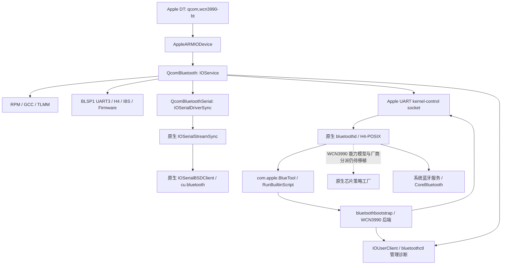

# SDM835 蓝牙驱动

`QcomBluetooth.kext` 已实现 WCN3990 的真实 UARTDM PIO 后端、RPM 供电投票、
GCC 时钟交接、TLMM 引脚租约、异步 BootROM 启动和 Patch/NVM 下载。
数据面接入当前 iOS 18 样本的原生 `IOSerialDriverSync`、`IOSerialStreamSync`
和 `IOSerialBSDClient`，并实现原生 H4/POSIX 需要的 Apple UART kernel-control
socket；设备匹配、串口设备创建和 PM 使用 Apple IOKit。
构建与验证继续使用 `scripts/toolchain.py`、现有 bridge 和 kernelcache 打包器。

本阶段完成驱动和 BlueTool 后端的代码与离线验证，没有连接、启动或测试真机。
新增 `bluetoothbootstrap` 实现原生 BlueTool 的三个初始化 XPC 请求，使用真实 HCI
应答核对下载后的控制器身份，保留原生 bluetoothd、Mach/XPC 服务和 H4 数据面。
但 **系统栈接通尚未完成：bluetoothd 自身的芯片能力模型和厂商分派仍没有 WCN3990 分支**。
串口发布不能证明 CoreBluetooth、扫描、配对或音频已可用。
默认 DT 节点保持 disabled；必须提供经过核对的 ROM、供电、电气配置和固件包才会启用硬件。

## Apple 内核态与用户态模型

参考样本：iOS 18.7.10 / 22H374，arm64 kernelcache SHA-256 为
`aa65c36c486a8b5cb1d7a2d565d1d6b3cc228b3c172f8c69c5da664ee19832cf`。
原生库依赖、personalities、用户态文件哈希和 launchd 配置见
[ios18-model.json](ios18-model.json)，串口布局证据见
[native-serial-evidence.json](native-serial-evidence.json)，BlueTool/XPC 与厂商工厂审计见
[native-bootstrap-evidence.json](native-bootstrap-evidence.json)。

- `AppleBluetooth.kext` 的实际类是 `BTReset : IOService`。当前样本没有
  `AppleBluetoothModule.kext` 或 macOS 的 `IOBluetoothFamily.kext`。
- 保留原生 `IOSerialFamily`，新增类 `QcomBluetoothSerial : IOSerialDriverSync`。
  原生 `IOSerialStreamSync` 通过 Apple 元类工厂分配；其 personality 由原生
  `IOSerialBSDClient` 匹配，并负责创建 `/dev/cu.bluetooth` 和 `/dev/tty.bluetooth`。
- `IOSerialDriverSync` 为 136 bytes / 180 slots；`IOSerialStreamSync` 为
  152 bytes / 181 slots。串口 12 个方法位于 slots 168–179，stream init 在 slot 180。
  构建会核对镜像哈希、实例大小、虚表、每项导入以及实际绑定的原生 provider。
- bluetoothd 的入口检查串口路径，按服务名 `bluetooth` 查找 DT nub，并读取
  `local-mac-address`。bridge 提供与 NVM tag 2 一致的地址，驱动设置 nub 的
  IOService plane 名称供原生发现使用。
- 其实际 H4/POSIX 数据驱动使用 PF_SYSTEM / SYSPROTO_CONTROL stream socket，
  默认选择 Skywalk UART。通过样本中真实存在的 BT_HCI_TRANSPORT 配置，选择
  `H4:POSIX:com.apple.uart.bluetooth,3200000` 可使用非 Skywalk 分支的 read/write
  及 TIOCGETA / TIOCSETA socket options。设备路径检查本身不等于 tty 数据传输。
  本驱动用 XNU ctl_register / ctl_enqueuedata 接入该分支，connect 要求样本中
  bluetoothd 已携带的 `com.apple.bluetooth.control` entitlement。
- bluetoothd 还通过 `com.apple.BlueTool` 的 `RunBuiltinScript` 调用
  `boot`、`init` 和 `deepsleep`，并检查芯片初始化结果。请求外层是
  `kMsgId` / `kMsgArgs`，回复包含 `result`、`manufacturer` 和非空指针字符串 `firmware`。
  新后端遵循该协议，原生 BlueTool 二进制仍保留，离线 launchd overlay 将该服务指向新后端。
- `transport-encoding` 也由 bluetoothd 独立读取。固件 bridge 写入 H4 的 FDT cell 1，
  Apple DT 转换为四字节小端值；拒绝已有冲突值。
- bluetoothd 的 LEHardwareModel 工厂与 Vendor Specific Command 分派独立于 BlueTool。
  当前样本按 Apple 设备和内部 BCM/ACI/SRS 芯片范围选择策略，没有发现 QCA 分支。
  BlueTool 初始化成功不代表这项厂商策略已经移植，也不会把 QCA 厂商号改成其他厂商。



没有创建蓝牙 DEXT，也没有声明当前样本中不存在的 Apple HCI 基类。
参考项目 `Project_iOS2ARM` 的历史 iOS 12 私有模块仅用于理解分层，不参与编译。
Apple 公开的
[IOKit 匹配规则](https://developer.apple.com/library/archive/documentation/DeviceDrivers/Conceptual/IOKitFundamentals/Matching/Matching.html)
和 [IOSerialFamily 接口](https://github.com/apple-oss-distributions/IOSerialFamily/tree/1c12ee3d9ec665bb53d0151644408d25e54fe012)
作为框架参考，历史头文件的保留槽没有直接套用到 iOS 18。

## 硬件与生命周期

资源获取顺序为 Rails → ReferenceClock → Pins → UART → BootROM → Firmware。
每步可返回 Pending；继续操作由工作循环的定时源推进。获取超时或结果不明确时，
资源继续记为持有，直到释放得到确认。失败按相反顺序回收，停止失败保留该项及其前置依赖。

| 部分 | 实现 |
| --- | --- |
| 匹配 | `IOKitPersonalities` 匹配 `AppleARMIODevice` / `qcom,wcn3990-bt`；probe/start 复验 MMIO 和 IRQ |
| UART | 专用 BLSP1 UART3，`0x0c171000/0x1000`，SPI 109 / Apple 向量 141；与调试串口分离 |
| PIO | UARTDM 8N1、CTS/RTS、TX/RX IRQ、错误检测、RX stale 快照和尾字节处理；固定处理预算、有界队列、发送完成检查物理 TX empty |
| DMA 交接 | 初次接管时拒绝仍启用 BAM/DMA 的 UART；不把未知 DMA 状态当成已停止 |
| 供电 | 使用现有 RPM SetVoltage 协议和独立 Bluetooth consumer 13；只撤销自己的投票，保留共享与启动下限 |
| 时钟 | GCC AHB 37、UART leaf 53 和 root 14；单一 UART owner 接管启动 pin，并保留不回绕的快照 token |
| 改频 | 停稳 PIO → gate UART leaf → 改 RCG → 复核频率 → retain leaf → 配置 UART；GCC 的活动 sibling 检查仍生效 |
| 时钟回收 | 按原始 M/N/D/HID、force-enable 和 firmware pin 快照恢复，不依赖原始分频值出现在频率表中 |
| 引脚 | GPIO45–48，UART3 mux 2；受 DT 授权限制的排他租约，拒绝与 GPIO/IRQ 客户端并用；保存并复核恢复值 |
| BootROM | 2400 baud 关断脉冲 0xc0，115200 baud 启动脉冲 0xfc；关闭流控，确认 drain，等待 10 / 100 ms 后继续 |
| 固件 | 读取真实 SoC version，校验 product / SoC / ROM；切换 3.2 Mbaud，按 243-byte 段上传 Patch/NVM，检查真实 VSE、错误与超时 |
| HCI/IBS | 固件后发送标准 HCI Reset，真实 Command Complete 后发布串口；IBS 字节在内核处理，原生 tty 仅承载 H4 Command/ACL/SCO/Event |
| PM | 关闭请求进入命令门，异步停止；资源归零才确认 PM Off。普通服务终止在资源尚未释放时被拒绝 |

WCN3990 改波特率时先 deassert RTS，并在定义的切换窗口屏蔽 RX；重设 UART
及 H4 decoder 后才恢复接收，避免将切换期间的 vendor indication 当成稳定速率的 HCI 数据。
固件阶段不注入伪 Command Complete，不以队列入队代替物理发送或控制器应答。

H4 在增量输入中校验方向与长度；ACL 主机缓冲上限为 4096 bytes。
接收溢出、UART 错误或非法帧导致当前传输失效，不在 payload 中搜索包头重同步。
控制器输入带资源代次，旧代次及停止后的输入被忽略。
IBS 有独立 TX/RX 状态与额外时钟引用；最后一个休眠字节离开 UART 才撤销该引用。
活动传输的基础 UART 时钟仍保留，深度休眠与外部唤醒不在本阶段支持范围内。

原生 tty 使用有界 32 KiB RX/TX 队列、排他打开、可中断的 gate sleep/wakeup、
水位、状态和 8N1 参数接口。发送端只将完整 H4 帧提交给 UART，flush 后已提交的
完整帧继续 drain。拒绝会吞掉 HCI payload 的软件 XON/XOFF，以及物理 break。
tty 的速率属性是加载完成后的逻辑参数，物理速率由固件状态机固定为 3.2 Mbaud。
HCI command credit 和 ACL credit 由用户态 HCI host 管理，内核不复制系统 HCI 调度器。
UART control socket 与 tty 共享排他的控制器会话；旧代次 socket 不能写入新控制器。
mbuf 在接收回调中复制后释放，RX enqueue 遇到 ENOBUFS 时保留完整帧并重试。
termios 72-byte 布局及两个 socket option 编号由真实 kernel SDK 的静态断言复核。

## 固件和板级策略交接

输入 profile 的格式见 [profile.schema.json](profile.schema.json)。必须明确提供：

- ZIP 归档、Patch、原始 NVM 的 SHA-256 和归档内路径。
- 预期 product / SoC / ROM、与 NVM tag 2 一致的真实 local_address。
- 已核对的 RPM rail ID、目标电压、最小/最大值、启动下限和 GPIO 电气配置。

没有通用电压模板、自动生成地址、按文件名猜 ROM 或其他产品 NVM 的回退。
准备步骤按现有 RPM catalog 校验资源范围，只修改 NVM tag 17 的 IBS 位和
3.2 Mbaud 选择值，以及 tag 27 的休眠位；保留地址、RF 与校准数据。
manifest 记录原始 NVM 哈希、准备后各文件哈希和每一处字节修改。
内核在任何硬件访问之前再次检查布局、ROM 字段、传输位与 MAC 一致性。

```sh
make prepare-bluetooth BLUETOOTH_FLAGS='--firmware-archive /path/to/assets.zip --firmware-profile /path/to/profile.json --output build/bluetooth/firmware'
```

在现有 scripts/build-bridge.py 构建命令中加入
`--bluetooth-firmware build/bluetooth/firmware`，即将该 bundle 交给 bridge。
bridge 核对所有哈希后，一次性合并 GCC、RPM、TLMM 权限与 Bluetooth 数据；
遇到冲突或畸形记录不修改设备树。配置是固定 104-byte 小端 opaque ABI，
固件与 MAC 原样保留为字节数据，资源 cell 正常转换为 Apple 小端 DT。
未指定此参数时，原有 DT 与 disabled 状态保持不变。

prepare-bluetooth 可额外传入
`--bluetoothd-plist build/bluetooth/reference/com.apple.bluetoothd.plist`。
工具校验原始 launchd 文件哈希，在输出目录生成 com.apple.bluetoothd.plist，
只增加上述 BT_HCI_TRANSPORT 环境变量，保留原始用户、Mach/XPC 服务和所有其他配置。
该文件仅作为离线交接产物；bridge 记录其是否准备，**不会安装它或修改根文件系统**。
此配置选择已实现的数据接口，不会绕过 BlueTool 初始化结果或伪装厂商命令成功。

## BlueTool 初始化后端

`drivers/bluetooth/userspace/BlueToolService.cpp` 使用原生 launchd/XPC Mach service。
只接受审计身份具有 `application-identifier=com.apple.bluetoothd` 且携带
`com.apple.bluetooth.internal` 的连接；不提供外部脚本或任意命令执行。
后端使用独立 `org.darwin.bluetooth.bootstrap` entitlement 打开 IOKit bootstrap client，
管理员诊断 client 与其授权分开。该 client 只提供状态、策略快照和带代次比较的电源请求，
不提供寄存器或固件原始写入口。

`boot` / `init` 接管或等待同一轮异步启动，检查 UART、固件、Reset 和两个原生端点已完成。
随后排他打开 Apple UART socket，依次发送以下真实命令：

1. Read Local Version Information，核对 HCI company 29。
2. QCA `0xfc00/0x19`，核对 product、SoC、ROM 和下载后的 Patch 版本。
3. Read BD_ADDR，与 NVM / DT / 请求地址核对。
4. Read Local Supported Commands、Read Local Supported Features。
5. Read Buffer Size、LE Read Buffer Size，校验双模能力与缓冲上限。

只有真实完整回复、物理发送完成、端口关闭及最终代次一致才返回 `result=0`。
QCA version 查询的可选 Command Complete 可以在 VSE 前后到达，但不能单独构成版本证据。
错误、超时和中途失败会请求回收本轮电源；内核原子核对 expected generation，迟到的回收
不能关闭新一轮控制器。bootstrap client 也不能抢占仍存在的 tty 或 socket 会话。
后端在关闭前通过本端点的私有 `BootstrapHandoff` option 封存已校验的会话，封存后
禁止继续发送。缺少该标记的 bootstrap socket 断开或进程崩溃会由内核主动关机回收，
因此即使用户态取消请求未送达，迟到 HCI 应答也不能进入下一次主机会话。
该 option 仅用于新后端，原生 bluetoothd 的 socket 协议保持不变。

`deepsleep` 映射为完整关机，并等待资源归零；没有宣称支持尚未实现的深度保持/外部唤醒。
启动等待 20 s、单命令 2 s、整个开启操作 25 s、关闭 3 s，均小于原生 BlueTool 的超时预算。
回复中的 `manufacturer` 使用新增 `qcom` 报告标签，`companyID` 来自真实 HCI 回复。

```sh
make bluetooth-stack
python3 scripts/toolchain.py verify-bluetooth-stack
```

统一工具链核对四个原生输入的哈希并生成 `build/output/Bluetooth/`：

- `root/usr/libexec/bluetoothbootstrap`：arm64/iOS 后端。
- `root/System/Library/LaunchDaemons/com.apple.BlueTool.plist`：只改 ProgramArguments。
- `root/System/Library/LaunchDaemons/com.apple.bluetoothd.plist`：只增加 H4/POSIX 环境变量。
- `bluetooth.trustcache` 与 `manifest.json`：开发签名和交付校验。

所有原生用户、MachServices、启动条件和其他 plist 字段保持一致；两个 Apple 原始二进制未修改。
新工具使用显式工程签名，XML/DER entitlement 一致且特殊槽与代码页经过核对；不声明 Apple
CMS 或平台签名。产物只是离线 overlay，没有安装到根文件系统或加载到设备。
manifest 明确标记 `native_chipset_policy_ported=false`。在补齐 bluetoothd 的独立能力/VSC
策略之前，该包只能用于代码审阅和离线交接，不能称为可用的系统蓝牙栈。

本阶段仅用临时合成固件验证准备流程，测试结束自动删除；没有制作可用于真机的
板级 profile，也没有将未知板级资产误标为可用。

## 统一构建和离线验证

```sh
make test-bluetooth
make test-bluetooth-sanitized
make bluetooth
make verify-bluetooth
```

bluetooth collection 包含蓝牙 Kext、GCC/RPM/GPIO 及其平台依赖和原生
IOSerialFamily。产物为 build/output/Extensions/QcomBluetooth.kext、
build/output/bluetoothctl、build/output/kernelcache.bluetooth 及上述离线用户态包。
结果、哈希和实际执行的检查见 [validation.json](validation.json)。
没有新增 Python/Shell 构建脚本或机型相关命名。
Linux v6.12 的 UARTDM / QCA 硬件资料和固定 commit 的 Apple 串口资料见
[reference/sources.json](reference/sources.json)；参考文件不参与驱动编译，许可随文件保留。

离线检查覆盖真实 SDK 编译、原生 ABI、最终链接/重定位、GCC 改频与快照恢复、
pinmux 排他和恢复失败、启动取消、逆序回收、ROM/固件状态机、H4/IBS、UART
FIFO/drain、tty 设置/队列，以及固件包与 Apple DT 的端到端校验，并运行 ASan/UBSan。
新增初始化协议测试覆盖七项 HCI 查询、可选/迟到 VSE/CC、厂商/ROM/Patch/MAC 错误、
有界等待、关闭失败、旧代次清理及签名、trustcache 和 launchd 合约篡改拒绝。

bluetoothctl info/status/power 是管理员诊断接口。power 成功表示异步请求已接受，
使用 status 观察完成。BluetoothTransportReady 表示本驱动完成固件和 Reset；
BluetoothNativeTransportReady 表示 Ready 时串口 stream 与 UART control endpoint 均已发布；
BluetoothNativeStackReady 保持 false，明确表示系统 daemon 尚无成功运行证据。
missing-mask 中的 NativeStackABI 位也继续保留，避免把数据接口完成报告成整个系统栈完成。
下一项系统栈工作是移植 bluetoothd 内部的 WCN3990 能力模型与 VSC 分派，完成后再考虑真机验证。
