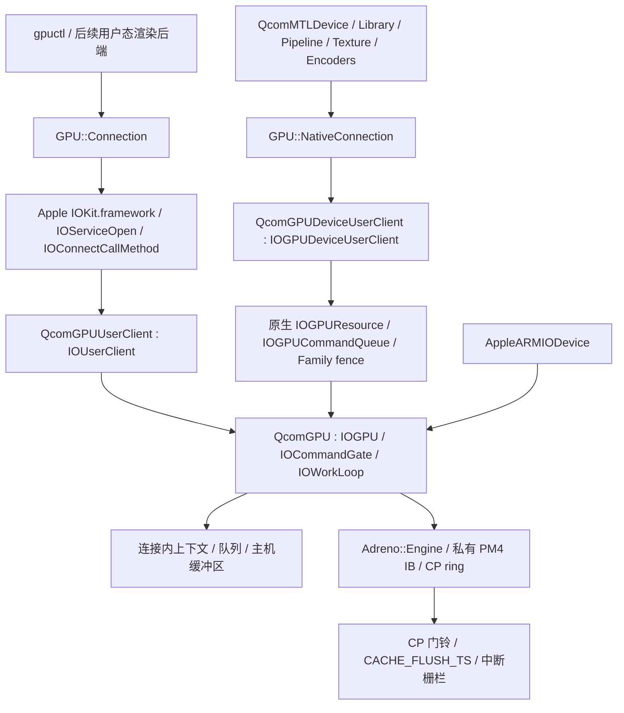

# Adreno GPU 初步驱动框架

Metal1.51.0 随驱动分发 121 个精确系统着色器变体及 200 个反射入口，
命中时跳过 LLVM/AIR/IR3 现场编译；另优化未命中时的 helper 清理和 NIR 复用。
已完成离线输出一致性、语义差分及内存检查，未做真机测试。
范围、原厂机制对照与配套要求见 [iOS18 冷编译与内置二进制](ios18-cold-compile-1.51.md)。

Metal1.48.0 减少不依赖采样模式的 fragment 重复编译；主机无 shader 缓存对照中，
Fluidity 四个特化的编译耗时减少 42.7%–45.1%，122 个完整程序映像与优化前一致。
未进行真机测试，适用条件和未改善样本见[冷编译优化记录](ios18-cold-compile-optimization.md)。

本阶段交付 SDM835 / Adreno 540 的 Apple IOKit Kext、用户态连接库、资源模型、
独立 kernelcache collection 和离线验证。驱动使用 Apple 的匹配、服务、用户客户端、
工作循环、内存描述符与电源管理 API。类名、bundle ID 和新增产物不带具体手机型号。
**已实现 A540 CP 硬件提交（Fill32/Barrier，原生连接另支持 Copy32）、原生 IOGPU buffer/异步准入队列桥接、DMA 映射、硬件栅栏、中断和超时隔离。
已加入保留或新建 bank 0 页表的设备 IOMapper、原生 SCM/PAS ZAP 恢复，以及引导桥的
CP/PFP/GPMU 固件启动、签名 ZAP 装载、SMMU 初始化和状态交接；新增桥内 RPM ACK、
CX/GX 与私有 GPU 时钟启动及原生 RPM 通道接续。仍需明确的资源策略和固件提供的共享
控制总线、XO/GPLL0、PLL 模拟配置。引导桥现已在真机通过冷启动、固件响应、PAS 认证和带边界检查的 DMA 提交；原生内核接管、用户态设备查询及累计 5 笔异步提交/回读已通过。round63已取得原生系统合成器5笔Render和2笔transfer的真实完成；完整UI、实屏显示与动画流畅度仍未验证。
已接入有界的原生 CP 故障恢复：固定只读固件映射，排空失败作业和原生回调后复位，
重建 CP/GPMU、再次恢复 ZAP 并用新的非安全 timestamp 验证；SMMU/平台失效仍保留隔离。
新增可显式创建的 Metal MSL/AIR AOT / JIT shader、Render/Compute 和线性纹理适配；
已接入8路MRT独立混合、颜色写掩码、局部视口、剔除/绕序、UInt16/UInt32 索引、实例绘制，
D32/S8 深度/模板附件与比较/模板操作、MTLVertexDescriptor/VFD 顶点输入，以及 float32 顶点/片元 varying 和透视/非透视/flat 插值；已有受限的设备端编译、片元深度/discard，以及2×/4× MSAA和GPU颜色resolve。
已接系统 Metal 插件入口、真实 `_MTLDevice` 基类、limits 和离线 bundle 暂存；
完整 AIR ABI 仍未实现。真机已验证引导阶段 GPU 提交和原生队列；系统 Metal 发现、JIT Compute/Render、AOT 与原生 IOSurface 的纹理像素回读已通过，系统 UI 加速待验证。**
详见 [Metal 适配说明](metal.md)。

当前实际镜像为 GPU **1.88.0** / Metal **0.77.0** / Display **1.0.11**。Metal0.77修复原版QuartzCore缺失的四参数线性纹理SPI，round71同启动完成22笔合成GPU作业且无匹配的UI进程崩溃。round73已通过真实VBIF halt建立显示MMU页表、内核IOMapper接管及GPU表面的DPU直接扫描；新IOVA、4352行跨度、原生完成等待及全部参考像素一致。保持原生屏幕唤醒后，系统合成器仍停止新增作业，完整Welcome与动画流畅度未通过；详见[当前审计](hardware-bringup.md#当前离线进度与欢迎页停帧)。

以下保留GPU **1.87.0** / Metal **0.75.0** / RPM **1.14.0**及Display **1.0.7**的阶段记录，不能替代上述最新启动结果。Shader37/JIT34、私有 Surface metadata2。round-53 使用修正后的 Compute 装载顺序，JIT 空内核、单 SSBO 常量写入和 AOT `add` 共三笔 Compute 已在内核端完成，失败数为0，未再观察到 SMMU 故障。Metal0.67 的诊断发现原版 IOGPUFamily 的开始通知同时带有非零的开始、结束时间；旧解析器错误地拒绝该合法通知，因此尚未取得这些着色器的输出回读。0.68 按已准入的 token 对识别开始和结束，只有 FIFO 结束通知才能退休作业，并让同步等待复用同一个通知窗口；round-54 已通过64资源两笔异步回读、设备端JIT单SSBO常量写入及保护字、AOT add的64个结果。两笔Render在硬件端完成，但纯红与AOT颜色像素回读失败，LCD原生帧计数和compositor提交仍为0。1.85将FS代码、常量与描述符移到图形HLSQ更新之后；round-55 已通过4096像素的JIT纯红绘制和完整AOT Compute/Render/私有纹理上传与采样回读，同一次启动还通过原生IOSurface带偏移与行跨度的导入、渲染、blit、采样、共享别名和seed回读。900字Render字流全部解码。系统合成器仍无GPU提交；round-55的原生图层等待未通过，round-58的waitForRendering虽返回1，实际DPU帧仍是文字日志，不能把离屏像素或等待成功当作系统UI加速。下文各版本段落保留其阶段记录。继续使用 Apple Metal、CAMetalLayer/CAMetalDrawable、IOSurface 和 IOGPUFamily。原生 MTLFunctionDescriptor 接入已有 AIR/JIT 特化缓存，Render/Compute 支持 descriptor/options 和异步创建入口，保留原版描述符、常量对象与完成回调签名。附件读取 draw 仍由 A540 后端按完整图元拆分私有64 KiB命令缓冲区，共用一个原生作业和最终 fence。GPU 优先级已接入原生队列和软件准入调度；管线反射、动态链接、更多格式及显示 fence/scanout 仍待完成，系统 UI 加速未验证。详见 [原生管线接口](../../drivers/abi-22H374/native-pipelines-abi.json)与[大 draw 提交](../../drivers/abi-22H374/draw-batches-abi.json)。

Metal0.69已在真机消除原版CARenderer的protectionOptions缺失接口异常，但目前仍未取得原版图层的GPU绘制。Display1.0.2依据同版QuartzCore的实际读取位置，在IOMFBMaxSrcPixels中声明不支持Apple压缩IOSurface，保留对压缩字节布局的拒绝；正在进行硬件验证。Bash的Interactive策略已实际部署，后续多轮EFI至可用控制台稳定约24秒、priority31。详见[最新真机记录](hardware-bringup.md#round-58metal保护接口通过原版渲染仍未绘制)。

GPU1.86 / Metal0.70将原版Metal的DWORD任务归属提示按命令顺序复制到内核作业，完成后可读取元数据；私有命令版本4，系统能耗计费仍未接入。交叉编译与集合验证已通过；round60复用现有探针验证版本4的64资源异步回读及4096像素Render。原版CARenderer现卡在fixed_frag_lph_cpf的AIR函数常量特化，系统UI与非空任务前缀的硬件验证仍未完成。详见[原生IOGPU桥接](native-iogpu.md)。

round61的Metal0.71诊断定位到目标typed-pointer AIR将向量常量查询保留为全零GEP，主机opaque-pointer LLVM已将其折叠。Metal0.72补齐有界的零偏移别名识别，继续拒绝内部地址与未知常量；主机原版AIR特化与非零偏移拒绝检查通过。round62在进入XNU前因GLINK OPEN_ACK解析被拒，尚未执行新Metal；当前设备充电，目标验证暂缓。错误前部保留实际AIR哈希和常量值，现有远端图层诊断加180秒期限。系统UI GPU渲染与动画尚未验证。

Metal0.73继续离线补齐原生合成AIR的内部辅助函数：按所选入口逐轮内联，并把辅助函数使用的常量纳入系统Metal反射、特化与缓存键。原版fixed_frag_lph_cpf的darken/lighten和颜色矩阵分支由失败变为可生成A540代码；一个顶点及六个有效片元变体通过生产JIT校验。主机检查和iOS交叉构建通过，未执行目标Metal/LLVM或连接设备。新候选复用GPU1.86/Display1.0.4/RPM1.14集合，详见[编译范围与限制](metal.md#air-辅助函数与原生合成特化)。

Display1.0.4补齐原生默认IOSurface模板的ID和全屏矩形，严格接纳默认画面intent6及全层清除、零背景的intent7；后者实际写入黑帧并沿DPU flush和真实中断完成。RPM1.14修正共用桥接/内核GLINK OPEN_ACK接收，资源ACK校验保持不变。现有主机检查、arm64 Kext及74项集合校验通过，配套离线候选已构建，均未做新一轮真机验证。详见[控制事务桥接](hardware-bringup.md#离线原生控制事务桥接)。

Metal0.56 将小块 blit 按实际 A540 PM4 容量批量提交，并把至少16 KiB的对齐填充、连续或带行跨度的拷贝交给真实计算着色器。保留行间 padding、边缘字节、物理别名检查和原生完成栅栏；计算 clear 也服务现有 Render loadAction。新 registry 要求 Kext、插件和默认库配套。详见 [批量拷贝与填充](metal.md#批量拷贝与填充)。提交数量减少属于离线规划结果，尚无新版本硬件性能数据。

Metal0.57 将非对齐拷贝和填充也交给 GPU，移除 blit 中的 CPU 像素读取与逐字往返，支持没有 CPU 映射的私有 IOSurface。每个线程独占一个完整目标字，保留窄纹理的相邻字节及行间 padding。Metal 与内核共用精确跨度判断，内核冻结拷贝/字节填充参数并检查实际物理字节范围；所有 IOSurface 拷贝都经过完整布局检查。132个入口的新 registry 为 ecb2551f170a2bb0，插件与 Kext 必须配套。见 [字节拷贝与参数冻结](metal.md#字节拷贝与参数冻结)。

Metal0.58 补上原版 MTLFence、Blit/Compute/Render fence 接口和 buffer/texture memory barrier。fence 逐次记录真实 IOGPU 完成点，等待捕获的多个生产者，不能用后一次完成替代未完成的前一次。依赖等待暂停 FIFO 队首并让出提交目标，事件使用有界后台等待；原生提交标记处理同一串行目标上的 commitAndWaitUntilSubmitted。该同步阶段的内核与 Shader registry 为1.67/ecb2551f170a2bb0，新增状态机检查沿用现有测试文件，端到端验证归入现有 metalctl fence-test。见 [Metal fence 与编码器同步](metal.md#metal-fence-与编码器同步)。新路径尚未在真机执行。

GPU1.68 缓存已退休的内核私有64 KiB命令缓冲区，避免逐笔重新准备 DMA 映射；通过原生 IORegistry 的 GPUStatistics 发布按作业类型和提交阶段拆分的统计。gpuctl stats 可单独读取，标记作业与像素工作分别计数。缓存及统计仅通过离线构建核对，尚无真机性能收益数据。详见 [提交缓存与统计](hardware-bringup.md#提交缓存与统计)。

GPU1.69 / Metal0.59 将普通 Render/Compute/blit 接入最多16笔作业的有界异步窗口，消费原生 Family 结束通知；容量及资源背压在进入 Family、消耗 token/fence 前返回专用延后状态。四个内建 blit 的参数均冻结，分批 CP 拷贝按已接受的位置继续。完成回调保持 FIFO，私有准入标记与公开 Scheduled 分开；显示仍在真实退休后调用原版 drawable。新路径尚无真机验证。见 [有界异步提交](metal.md#有界异步提交)。

GPU1.70 / Metal0.60 将原生资源命名空间与单作业引用拆开：每连接最多1024个资源、单作业64个、64位表面写标记。字节上限来自实际 IOVA 窗口，当前离线256 MiB策略对应连接128 MiB、全局192 MiB；单资源仍至多16 MiB。DMA账本扩为4096项并按地址一次扫描分配，保留guard、TLB退休和隔离规则；gpuctl stats 加入内存计账与映射快照。新资源规模和IOSurface别名处理仍待真机验证。见 [原生资源规模与计账](native-iogpu.md#原生资源规模与计账)。

Metal0.61 实现原生 MTLBuffer 的线性2D纹理视图、64字节对齐查询及来源元数据；视图复用 buffer 的 IOGPU ID和分配，保留偏移、行跨度与父对象。已接既有 CPU/shared、blit、Compute、采样与渲染后端。单mip/layer/sample、现有六种颜色格式，不支持 texture-buffer 类型。详见 [buffer 纹理视图](metal.md#buffer-纹理视图)。现有 blit-test 加入带偏移和padding的GPU回读探针，尚未真机执行。

Metal0.62 接入 Apple MTLHeap 的自动及指定位置分配、buffer/纹理大小与对齐查询、资源别名状态和生命周期。每个heap共用一个原生IOGPU buffer，子资源复用已有纹理布局，并把公开相对偏移一次转换为backing偏移。沿用当前单分配16 MiB上限；Sparse、memoryless及可丢弃内存尚未接入。见 [原生资源heap](metal.md#原生资源heap)。已有blit-test追加heap负载与完整backing的guard回读，未在设备运行。

GPU1.71 / Metal0.63 将 Render load-clear 改为专用GPU行填充，只写有效像素宽度，保留padding和字边缘。新32字节参数沿用内核校验及只读IB冻结，五个内建blit的layout能力版本为2；原有四个布局保持不变。新增133号AOT入口，registry为a74b60151e63e259，Kext、插件与默认库须配套。见 [按像素行清屏](metal.md#按像素行清屏)；新增目标clear/guard探针仍未执行。

D32、S8、D32S8 已接通 mip 链、数组及嵌套视图，逐级 render/blit 和 D32 shader 读取共用格式对应的布局。深度比较采样直接生成显式 LOD 指令，保留跨 mip 的比较后过滤；普通梯度采样的坐标与梯度表达式只求值一次。S8 shader read 和 depth cube 尚未接入；自动生成 mip 仍限颜色格式。见 [深度 mip 链和梯度参数](metal.md#深度-mip-链和梯度参数)。

上一阶段 GPU1.52.0 / Metal0.42.0 新增2×/4× MSAA数组：颜色 CS/VS/FS 读取与查询、数组范围和2DMS切片视图，以及颜色/深度/模板数组切片的渲染、复制和 resolve。D32S8 保留独立的深度/模板层步长；跨切片复制在记录前核对两类平面。Shader31/JIT28、Texture48/Sampler28/Dispatch824/Draw2816、description2424/image41832 bytes 需配套。该功能属于工程自有编译器/原生驱动 profile，不代表 Apple iOS Metal family 兼容。见 [MSAA数组与切片](metal.md#msaa数组与切片)。当前核验以 `validation.json` 为准。

启动桥新增 [CP DMA 提交与读回](hardware-submission.md#桥内-cp-dma-提交与读回)：ZAP bootstrap 使用生产用 Encoder/Engine 提交 Fill32、Copy32 和 Barrier，等待硬件 timestamp，核对数据与整页边界，再 halt/drain 后发布原生交接。IB 单独只读映射，复用现有16 KiB保留页；停机时锁存的错误不会被中断清除掩盖。五种 EFI/raw 构建模式及现有主机提交检查通过；这是启动桥改动，Shader/JIT ABI 保持上述值。这条引导桥路径已在真机执行通过，不能据此认定原生 IOGPU 或 UI 加速已经通过。


真机调试记录见 [硬件启动与接管](hardware-bringup.md)。已修复本地 Kext 常量被误当指针重定位的问题；原生资源接管、新内核 ring、私有地址空间启动自检和用户态异步提交通过。系统 Metal、UI 加速和动画流畅度仍在验证。

Metal0.64 补齐原版无保留引用命令缓冲及 descriptor 模式，Blit/Render/Compute、fence/event 按实际模式管理资源；内部 inline bytes、resolve 参数和合成辅助资源仍由驱动保留。归零弱引用在准入前拒绝失效对象，临时持有在锁外释放；现有 blit-test 编入相关检查但尚未在设备执行。GPU内核与registry不变，系统UI与性能仍未验证。见 [命令缓冲的资源引用](metal.md#命令缓冲的资源引用)。

Metal0.65 接入原生 MTLBinaryArchive 的 Compute/Render 函数持久化、精确函数/管线查找及严格未命中错误。A540容器校验编译器与系统指纹、完整文件和引用图；内建代码保留为AOT引用，动态IR3按需恢复。AIR函数 descriptor 命中跳过lower/IR3，MSL源库创建仍为原有方式。现有主机检查通过，原生重载/GPU读回探针未执行。见 [原生二进制归档](metal.md#原生二进制归档)。

## 分层与已实现内容

成为可日常使用的完整驱动，还需要完成以下路径。离线交叉链接只证明当前实现的
结构、导入和列出的不变量，不能把尚未接入或未在硬件运行的部分标成完成。

| 路径 | 当前状态 | 后续必须完成的工作 |
| --- | --- | --- |
| A540 执行与回收 | EFI 冷启动/DMA、原生资源接管/内核 ring 初始化通过；故障恢复路径尚未真机验证 | 用户态负载、故障恢复、SMMU/平台故障恢复和睡眠恢复 |
| DMA 与隔离 | EFI bank 0、原生 IOMapper 和私有地址空间启动自检通过；已有硬件切换、TLB 退休及故障保留 | 持久任务 VA 分配器、非特权 ISA 隔离、用户态负载和故障验证 |
| Apple IOGPU | 已接原生 buffer / 线性 IOSurface、异步准入与真实 Family 结束事件、任务/资源生命周期及通知 | 多平面/压缩表面、通用工作队列及更完整的原生同步 ABI |
| Shader 编译 | MSL/AIR AOT/JIT、分支/循环/提前返回、AIR phi 合流、实例输入与 float32 varying | 更完整的类型/内存模型、更多原子类型与内存序、argument buffer 与完整语言/链接能力 |
| Render/Compute | 已有8个颜色目标及独立混合、深度/模板 mip 附件与视图、顶点描述符、索引/实例绘制、varying 链接、动态共享内存、线性 mip 纹理、Compute 读写、颜色 mip 生成和 framebuffer fetch 的 GPU 快照 | layered rendering、更多原子/格式和通用寻址 |
| 系统集成 | 原生 Metal 插件入口、框架基类/limits、IOSurface/drawable 导入、原生 present/共享事件桥接、基本 GPU 图层合成；`graphics` 统一集合和离线 rootfs/信任缓存 | 实际插件加载、CoreAnimation 库/着色器和 CARenderServer 接入、通用应用权限、无 CPU 等待的显示 fence/scanout |

GPU 1.45.0 / Metal 0.35.0 已把 Compute 纹理读写接入原生 IOGPU → A540 提交桥：8 个独立纹理槽、动态 mip、RGBA8/BGRA8（含 sRGB）转换和范围检查；Compute 硬件采样另支持独立的 8 个 sampler 槽和 LOD clamp。现已加入 sampler 地址模式、边界色、各向异性、MSL gradient2d，并修正显式 LOD 的 clamp 行为；可与动态 threadgroup 参数共用。颜色纹理 mip 链、LOD/mip 过滤、逐级 CPU/blit/render 访问及原生 Compute 生成已接通。sRGB 采样在过滤前解码，渲染目标、Compute 写回与清屏按线性 RGB 编码，alpha 保持线性。现已支持 Compute/Fragment device buffer 与 Compute threadgroup 的 32-bit 整数原子，
包括 relaxed 读写、RMW 和带线程内 expected 回写的比较交换。MSL、AIR intrinsic 及 LLVM 原子指令
均接到受范围检查的 A540 后端，见 [整数原子](metal.md#32-bit-整数原子操作)。

GPU 1.28.0 / Metal 0.18.0 加入 Compute 静态 threadgroup 标量/向量/数组、AIR 地址空间 3 全局变量，
以及共享内存和 device buffer 的工作组屏障。实际用量传至原生准入及 Metal pipeline，容量为 32 KiB，
见 [共享内存](metal.md#threadgroup-共享内存与屏障)。动态参数见 [后续适配](metal.md#动态-threadgroup-参数)，更完整的内存模型仍待完成。

GPU 1.27.0 / Metal 0.17.0 接入 Fragment buffer / 常量参数 / inline bytes，并桥接 A540 的共享图形 SSBO 表。
Vertex 与 Fragment 各有独立的 8 个槽，支持 Fragment buffer 读写和实际范围检查；
连接资源容量扩为 32，见 [Fragment 桥接](metal.md#fragment-buffer-到-a540-的桥接)。

GPU 1.26.0 / Metal 0.16.0 加入一般数组下标、常量引用/结构体字段、Compute/Vertex inline bytes，
以及共享 NIR load/store 字节检查；旧程序和 VFD 的静态 footprint 保留，见 [buffer 访问](metal.md#常量参数与受检查的-buffer-访问)。

GPU 1.25.0 / Metal 0.15.0 加入可变 Compute 工作组、三维均匀网格和完整坐标输入。
统一检查驱动参数、NDRANGE、线程/调用总量及既有 buffer 下标证明，见 [Compute 工作组](metal.md#compute-工作组和系统输入)。

GPU 1.24.0 / Metal 0.14.0 加入 MSL 控制语句和 AIR 基本块/phi/循环编译，
AOT 与运行时 JIT 均输出真实 A540 指令，保留既有资源边界检查，见 [控制流编译](metal.md#控制流编译)。

GPU 1.23.0 / Metal 0.13.0 接入系统 Metal.framework 的 `initWithAcceleratorPort:` 加载模型。
主类真实继承 `_MTLDevice`，保留独立服务端口引用，按已实现功能提供 limits。
统一构建生成系统 bundle 目录和工程信任缓存，`metalctl --system info` 使用真实系统发现入口。
ABI 来自实际 22H374 用户态库，见 [Metal 插件说明](metal.md#系统插件入口)；未执行目标加载。

GPU 1.22.0 / Metal 0.12.0 新增每作业独立的 GPU 页表和 ASID，实际 ring 在执行前后切换根。
IB、着色器和 ring 以只读方式映射，内部绘制 timestamp 使用独立页；真实完成和 TLB 退休后才复用 ASID。
启动/恢复自检成功才开放原生隔离提交，见 [私有 GPU 页表](native-iogpu.md#作业私有-gpu-页表)。

索引绘制将完整索引复制到作业私有 DMA buffer，基于同一份数据检查顶点范围；
实例编译链独立记录 buffer 的顶点/实例索引来源，详见 [Metal 说明](metal.md)。
新增的 stage 接口按语义名称而非声明顺序链接，内核验证活跃分量后才生成 A540
插值状态。MSL AOT 已复用设备 JIT 的 C++ 前端，移除了 Python 中重复的语法转换。



| 层 | 文件 | 当前行为 |
| --- | --- | --- |
| Kext | `drivers/gpu/QcomGPU/Info.plist` | `AppleARMIODevice` + `IONameMatch=qcom,adreno-540.1` + `IOProbeScore=1000` |
| 服务 | `QcomGPU.cpp` / `QcomGPUNative.cpp` | 原生 IOGPU 生命周期、资源/异步准入和 Family 退休、共享工作循环、PM、连接配额 |
| 用户客户端 | `QcomGPUUserClient.cpp` | 管理员连接、参数尺寸检查、同步请求、close/death/stop 资源回收 |
| 资源 | `GPUResources.h` | 连接内带代数/类型的句柄、上下文父子关系、缓冲区配额、提交范围检查 |
| 硬件提交 | `AdrenoSubmit.h` / `QcomGPUHardware.cpp` | 受控命令编码、32 KiB ring、门铃、真实栅栏、中断/watchdog 和 DMA 隔离 |
| DMA | `QcomGPUBuffer.cpp` | Apple IOMapper + IODMACommand 映射、内存准备/清理、等待完成后释放 |
| 执行隔离 | `AdrenoAddressSpace.h` / `QcomGPUMapper.cpp` | 每作业独立页表/ASID、只读 IB、切换与 TLB 退休、启动/恢复自检 |
| EFI 启动与恢复 | `boot/bridge/gpu_handoff.cpp` / `AdrenoStartup.h` / `AdrenoRecovery.h` | 共享 CP/PFP/GPMU 初始化、固件映射交接、bank 0 页表、ZAP 及有界原生 reset |
| 公共协议 | `drivers/include/GPUUserProtocol.h` / `GPUNativeProtocol.h` | 固定宽度标量、版本、能力、阻塞位、内联拷贝上限 |
| 用户态 | `tools/gpuctl/GPUConnection.{h,cpp}` | 可复用 C++ 连接库、版本握手、资源读写/释放、提交/栅栏接口 |
| Metal 子集 | `drivers/gpu/QcomMTL` | 公共 Metal MSL/AIR AOT / JIT shader、Render/Compute、线性纹理和 blit，原生资源/真实完成通知、显式工厂 |

Apple 的 `IOBufferMemoryDescriptor` 实际分配并清零主机缓冲区。读写在 gate 内完成，
诊断连接只通过内联结构拷贝；不暴露物理地址或 MMIO，也没有用户可改写的 CP ring。
原生连接沿用 Family 的 CPU 映射及 IOVA 返回数据，但提交只解析当前设备的资源 ID。
不会把 CPU PA 当作 GPU VA。硬件模式通过 `IODMACommand` 取得连续 IOVA，
所有软件队列共享单个串行 ring，命令只能访问同 context 下的缓冲区。

所有客户端共用服务工作循环。原生提交完成准入即返回，IRQ/watchdog 退休作业后再推进 Family 事件；原生关闭先排空调用再在 gate 外清理。
服务停止时关闭所有会话；
gate 保留到服务释放，使已建立连接仍可安全完成关闭。Kext 按项目现有 C++ 约定常驻，
拒绝服务卸载。PM 两个状态只控制软件请求准入，保留主机资源；不控制物理电源，
不宣称支持系统睡眠、GX/CX 电源门控或 GPMU 调频。

## iOS 18 和 Apple 框架分析

已检查项目当前 iPad7c arm64 kernelcache，SHA-256 和提取结果保存在
[`ios18-model.json`](ios18-model.json)。它是 iOS 18.7 internal / 22H368 的样本，
项目编译 SDK 是 iOS 18.6。不能把样本标签混称为完全一致的版本。

| 原生类 | 父类 | 实例大小 | 已恢复虚表槽数 |
| --- | --- | --- | --- |
| `IOAcceleratorES` | `IOService` | 136 | 168 |
| `IOGPU` | `IOAcceleratorES` | 744 | 215 |
| `IOGPUDeviceUserClient` | `IOUserClient` | 304 | 189 |
| `IOGPUDevice` | `IOGPUObject` | 256 | 29 |
| `IOGPUCommandQueue` | `IOGPUObject` | 1408 | 36 |
| `IOGPUResource` | `IOGPUObject` | 160 | 33 |
| `AGXAccelerator` | `IOGPU` | 8616 | 未恢复 |

样本包含 `IOGPUFamily 104.6.4`；AGXG9P personality 匹配 `AppleARMIODevice` 的
`gpu,t8010`，设置 `IOMatchCategory=IOAcceleratorES` 和 `MetalPluginName=AGXMetalA10`。
当前已按该映像恢复并接入原生服务生命周期、任务和事件机启动钩子、设备查询，
以及 buffer 资源、异步命令准入和真实 Family fence 到 A540 的桥接。`QcomGPU : IOGPU` 使用原生加速器匹配类别和 Family 工作循环；
`gpuctl native-info` 使用类型 1 的原生连接。具体 ABI、选择器和边界见
[`native-iogpu.md`](native-iogpu.md)。原生提交限定为受控 Fill32/Barrier/Copy32 和内置或管理员连接登记的 JIT ShaderDispatch/ShaderDraw，不发布未经验证的 Metal 插件键。

Apple 公开参考是 [驱动匹配模型](https://developer.apple.com/library/archive/documentation/DeviceDrivers/Conceptual/IOKitFundamentals/Matching/Matching.html)、
[IONameMatch](https://developer.apple.com/documentation/bundleresources/information-property-list/ionamematch)
和项目内同版 XNU 的 `IOService`、`IOUserClient`、`IOCommandGate` 实现。
参考项目 `Project_iOS2ARM` 的 AGX Kext plist 也遵循这类 provider/plugin 分层；
本项目运行和构建不依赖其绝对路径。

## 第三方 NVIDIA 参考

参考 [NullMoth NVIDIA 驱动的架构说明](https://github.com/nullmoth/nvidia-macos-driver/blob/db3716fde712f0542ef7fcec29226b26e99e07dc/docs/HOW-IT-WORKS.md)，
固定观察到的提交 `db3716fde712f0542ef7fcec29226b26e99e07dc`。
该项目将内核资源管理、显示/加速器适配、Metal 插件、着色器翻译和 Mesa 后端分层。
这里采用分层思路，未移植其实现代码，也未使用其 x86_64/macOS 私有 ABI。
着色器编译与 A540 状态参考固定版本 Mesa Freedreno/IR3，未链接 Linux DRM 后端。
Turnip 主要面向 A6xx 及后续 GPU；不能把 NVK/NAK、GSP 固件用于 A540。
Metal 插件加载协议和完整 AIR 编译链仍需要单独完成。

## SDM835 硬件边界

硬件参考固定于 Linux v6.12 提交 `adc218676eef25575469234709c2d87185ca223a`，
另检查了固定提交的 Qualcomm 下游 A5xx 寄存器/快照代码，
原文及 SHA-256 位于 [`reference/sources.json`](reference/sources.json)。
参考文件保留各自版权与许可证；新增驱动采用 BSD-2-Clause，基于 Mesa 状态序列的
AdrenoPipeline.h 使用 MIT 并保留来源说明，见 tools/gpu-compiler/NOTICE.txt。
原生 QcomSCM 服务及 SCM/PAS 实现采用 GPL-2.0-only，见 drivers/security/QcomSCM/NOTICE.txt。

- A540 rev1：chip ID `0x05040001`，GMEM 1 MiB。
- GPU MMIO `0x05000000 / 0x40000`，GIC SPI 300，level high。
- Adreno SMMU v2 `0x05040000 / 0x10000`；不能替换为 Apple DART/UAT。
- CP 固件 `a530_pm4.fw`、`a530_pfp.fw`；GPMU `a540_gpmu.fw2`。
- secure ZAP 是 `a540_zap.mdt` 及对应签名载荷；桥已接 MDT/MBN/分段装载和真实 PAS-13 认证。

仓库不分发 GPU 固件。40-byte `qcom,gpu-handoff` 用于接管
已完成 CP/GPMU/ZAP 初始化且停机的 GPU；检查微码地址、非安全状态、GPMU、
idle/ring/preemption 状态，再以真实硬件 timestamp 自检后启用提交。
GPU Kext 1.22.0 还要求同一 Apple arm-io bus 下的 `QcomSCM.kext`：保持 CP/AXI
隔离和电源/带宽租约，实际调用 `BOOT_SET_REMOTE_STATE(0, 13)` 恢复已认证 ZAP，
复查硬件状态后才建立新 DMA 映射，通过已认证的 CP_SET_SECURE_MODE 和 timestamp
证明非安全提交已可用。SCM/PAS 元数据初始化、内存设置、认证和关闭的内核接口也已实现。
调用结果不明会保留整个资源图到平台复位，详见 [SCM/PAS](hardware-submission.md#原生-scmpas-与-zap-恢复)。
`boot/bridge/gpu_handoff.cpp` 已接入统一的 `build-bridge.py --gpu-handoff-profile`：
在分配 XNU arena 前采集页表、排除所有保留映射，退出 EFI 后停止 CP、排空 AXI，
完成页表 cache/TLB 同步后填入 40/120/32-byte 属性。RPM 数据来自明确策略，进入 XNU
后仍需原生控制器真实 ACK；未把寄存器频率当成电压/带宽历史请求。该入口已完成离线
EFI/raw 交叉链接；增加 `--gpu-zap-firmware` 可装载签名 MDT/MBN 与 bXX 段，并通过共享
SMCCC/PAS 代码认证、运行隔离的 boot ring 自检。元数据、载荷及 boot 映射保留到复位。
再增加 `--gpu-firmware <目录>`，桥会装载原始 PM4/PFP/GPMU 文件，执行真实 GPU reset、
重查 SMMU、配置 A540 寄存器、发送 ME_INIT，并通过 CP 写入 GPMU instruction RAM。
该模式不再要求 CP/GPMU 已初始化，但仍要求可验证的时钟和 SMMU；策略需给出
`firmware_power` 的频率/电压，实际 GPUCC 频率必须匹配。GPMU 新应答、ZAP 认证和
非安全 timestamp 全部通过后才发布交接，详见 [固件启动](hardware-submission.md#cppfp-与-gpmu-固件启动)。
增加 `--gpu-smmu-init` 后，桥会为未启用的 bank 0 分配独占页表，按运行时能力配置
4 KiB AArch64 stage-1、SID 0 与 ASID 0，再从实际寄存器生成原生交接记录。
GPU reset 在配置新 SMMU 之前完成；冲突、写入未生效或 TLB 超时均停止交接。
该入口仍依赖已开启的电源/时钟，见 [SMMU 初始化](hardware-submission.md#smmu-bank-0-冷初始化)。
再增加 `--gpu-cold-start`，桥可从已关闭的 GX 启动：实际确认 RPM 电源/时钟/带宽请求，
开启 CX/GX、GCC/GPUCC 与私有 Fabia PLL、RBCCU/SP，配置 SMMU 后接续已有固件启动路径。
原生 `QcomRPM 1.4.0` 接收已排空并停止生产的 GLINK 通道，保留 FIFO 游标和消息序号。
该模式要求固定 MSM8998 OPP、足够的 CX/MX corner、明确电压及共享时钟/模拟配置，
详见 [桥内电源启动](hardware-submission.md#桥内-rpm电源与时钟启动)。
使用 `--gpu-firmware` 的三种模式还会在实际初始化成功后发布 64-byte 固件交接。
原生 mapper 固定 PM4/PFP/GPMU 的只读页，CP 错误或 watchdog 在实际 halt/drain 后可触发
最多三次服务生命周期内的恢复。失败作业和队列按错误结束，不重放；只有 GPMU、SCM/ZAP、
SMMU 和新非安全 timestamp 都成功才重新开放新队列。详见 [运行时恢复](hardware-submission.md#原生-cp-复位恢复)。
合成固件、策略和临时启动镜像已经删除；没有运行设备或生成可用固件/策略。
VA 上限为 49-bit，低 16 MiB 保留；实际映射由设备的 IOMapper 管理。
不使用 DMA bypass，不以标志代替实际 IOMapper。新增 retained SMMU mapper 会检查实际页表、空闲窗口和 stream/context 身份，保留固件映射；交接格式见硬件提交说明。

硬件就绪时 `GetInfo.features` 增加 `HardwareSubmit/GPUVirtualMemory`；固件页固定及私有页表自检成功后再增加 `NativeSubmission/SharedSurfaces/AsynchronousSubmit/IsolatedSubmit`，
`blockers` 只保留 Metal 位；原生 buffer/IOSurface/异步准入与完成桥接 ABI 已实现。IOSurface 导入支持线性 RGBA/BGRA plane 0，
共用原生 device cache、原始 DMA backing 和真实完成后的 cache/seed 同步；详见 [资源桥接](native-iogpu.md#iosurface-导入)。缺少交接则保留主机诊断模式；
交接存在但无效、自检失败或没有 IOMapper 时启动失败，不谎报硬件可用。

完整交接格式、提交协议、生命周期、故障隔离和测试范围见
[硬件提交说明](hardware-submission.md)。仍需完成实际平台策略、启动验证与故障回收，
以及多平面/压缩 IOSurface、通用 IOGPUWorkQueue、系统 Metal 插件加载和完整运行时着色器/渲染支持。

现有 `QcomDisplay` 保持独立；GPU 完成之后才研究 GPU 渲染表面与显示提交的同步。
本阶段已修改引导桥交接；显示路径保持独立，没有分发固件或执行真机操作。

## 用户接口与配额

`IOServiceMatching("QcomGPU")` 查找唯一服务，`IOServiceOpen` 类型为 `0x47505502`，协议版本 2。
连接只开放给管理员；类型/版本不匹配直接拒绝。该内部 iOS 接口不等同于公开
App Store SDK 的 GPU 驱动接口。`tools/include/IOKitUser.h` 与 powerctl 共用，
构建时对 SDK 的真实 IOKit 导出逐项核对。

ABI selector 的完整尺寸定义位于 `GPUUserProtocol.h`。上下文/队列/缓冲区创建和
销毁可用，Write/Read 使用最多 4096 bytes 的内联结构；异步和 OOL 结构拒绝。
单连接最多 8 contexts、8 queues、32 buffers，单 buffer 16 MiB，总计 64 MiB；
最多 8 个连接。代数耗尽后拒绝分配，不循环复用旧句柄。父 context 有子资源时
销毁返回 busy。Submit 接受 1..64 个固定布局的 Fill32/Barrier 描述符，
生成私有 IB 并写门铃；GetFence 返回按队列编号的真实完成状态或故障。
最多 16 个在途提交；在途目标 buffer 的 CPU 读写/销毁和队列销毁返回 busy。

## 统一构建与离线验证

```sh
make drivers                     # 包括 QcomGPU.kext
make gpu-client                  # arm64 iOS gpuctl + GPUConnection
make gpu-shaders                 # Mesa IR3 / LLVM AIR 前端 + A540 AOT 登记库
make gpu-metal                   # QcomMTLDriver.bundle + metalctl
make test-gpu                    # 全部驱动模型 + GPU 集成验证
make gpu                         # GPU 独立 prelinked collection
make verify-gpu                  # 使用保存的输入快照独立复验
```

所有构建仍进入 `scripts/toolchain.py`，复用 Kext 自动发现、KPI 导出验证、
依赖闭包、内核缓存链接和独立校验器。powerctl/gpuctl/Metal bundle/metalctl 共用一个用户态构建实现；
没有添加额外的构建、下载或清理脚本。GPU 资料的抓取只在本次研究中临时执行。

产物为 `build/output/Extensions/QcomGPU.kext`、`build/output/Extensions/QcomSCM.kext`、`build/output/gpuctl` 和
`build/output/kernelcache.gpu`，另有 `build/output/QcomMTLDriver.bundle` 和 `build/output/metalctl`。
用户态产物的 `.json` 记录输入/输出哈希与
`hardware_tested=false`。独立 collection 同样附带 manifest 与 verification 报告。

`tests/gpu_test.cpp` 验证资源图、失效句柄、代数耗尽、配额、越界、跨 context
提交和结构尺寸。`gpu_submit_test.cpp` 直接实例化生产用编码器与 MMIO Engine，
解释实际 PM4 来验证 DMA 写入、ring 满/回绕、完成、故障和 halt 隔离。
`test_gpu_integration.py` 核对实际 Kext 匹配/元类、真实
iOS 用户态链接及来源哈希。通过这些检查只证明框架离线成立。
本次产物哈希、通过的测试数量与日志位置见 [`validation.json`](validation.json)。

`gpuctl info` 和 `gpuctl resources` 是将来在目标系统人工执行的诊断入口；
后者只验证主机资源往返。`gpuctl fill-test` 显式执行 GPU 填充并核对硬件栅栏和数据。
本任务只交叉编译这些入口，没有在目标设备运行它们。

平台运行配置现由 `QcomGPUPlatform` 通过原生 `GenericARMIO` 平台函数持有：
只读接管 GPUCC/GCC，保护已确认的 RPM CX/MX 与 BIMC/EBI 下限，并在 DMA/SMMU 清理后释放。
普通 GPUCC 电源域获取可能复位 GX，因此 retained handoff 使用独立租约。
完整前提和失效保留规则见 [硬件提交说明](hardware-submission.md#保留运行配置的平台租约)。

GPU 1.22.0 通过 Apple IOResourceMatch 等待 GCC/RPM/GPUCC/SCM 四个服务，并可根据完整 RPM
域/时钟/总线交接主动确认初始基线。启动等待只在 MMIO/DMA 开始前进行，最多 10 秒。
引导桥已统一转换 GPU、SMMU 和 RPM 交接记录的字段大小端，并加入保留状态生产者；仍需实际平台策略及硬件验证。

GPU 的专用 BIMC port 1 bypass 和静态平均/峰值带宽租约已接入相同提交后端。
RPM 1.3.0 根据 GPU、USB 和 EBI/SNOC 平均流量的共同需求保护 BIMC 时钟，避免各自取峰值时低估总平均量。
硬件接管要求第三份 BIMC 资源和 32-byte `qcom,gpu-noc-handoff`，详见 [硬件提交](hardware-submission.md#gpu-的-bimcebi-路径)。

GPU 1.45.0 / Metal 0.35.0 还支持共享二维颜色纹理视图、嵌套 mip 子范围与相同格式的深度/模板视图。父资源随视图和命令保留，视图的 CPU/blit/render/Compute/采样使用真实子范围；复制与原生 alias 检查按实际字节范围。颜色 swizzle 已实现；二维颜色数组已实现；立方体颜色纹理已实现，数组深度及跨格式深度视图仍未实现。

GPU 1.45.0 / Metal 0.35.0 加入二维颜色纹理数组：层间 mip 链、嵌套 slice/mip 视图、逐层 CPU/blit/mipmap、单切片 Render 附件和 MSL AOT/JIT 的数组读写/查询/采样使用同一原生后端。物理别名检查按切片实际区间扫描，允许不相交的 mip/slice 共享 backing。Shader25/JIT22 配套使用 Texture44 / Dispatch792 / Draw2168 / Sampler28 bytes。AIR 数组签名、数组深度和分层 Render 尚未完成；仍未执行目标系统，完整 family 保持关闭。验证记录见 validation.json。

GPU 1.45.0 / Metal 0.35.0 接通顶点纹理采样：VS/FS 的 texture/sampler 槽位、LOD 与常量区独立，MSL 支持二维及颜色数组，AIR 支持已有二维 sample 签名。顶点采样可驱动几何 Z 和颜色输出，资源沿用真实原生 fence 生命周期。Shader25/JIT22、Draw2168 bytes 需配套部署。当前每个图形阶段支持8个 texture 槽和8个独立 sampler 槽，AIR 数组/gradient、完整 Metal family 和目标运行验证仍未完成。

GPU1.45.0 / Metal0.35.0 将图形纹理扩为每阶段8个texture和8个独立sampler，支持稀疏槽、交叉配对、范围绑定与每槽LOD快照。MSL/AIR到A540的组合句柄拆分共用Compute的索引模型，VS/FS资源和状态保持独立。Shader25/JIT22配套使用Draw2168 bytes；完整family及目标运行仍未验证。

GPU1.45.0 / Metal0.35.0支持颜色Cube/CubeArray的创建、面/mip视图、逐面CPU/blit/Render/mipmap及MSL VS/FS/Compute采样。原有54个A540代码保持一致，新增4个cube示例。Shader25/JIT22及扩展描述符需配套部署；AIR cube、完整family仍待完成，未进行真机测试。

GPU1.45.0 / Metal0.35.0继续补齐Compute Cube/CubeArray的直接读写、read_write和尺寸/mip/元素数查询，新增4个MSL示例（共62个AOT程序）。同时接入A540内存取指与图形共享代码缓存分配，代码配额16KiB，Shader25/JIT22、image20296 bytes需配套部署。现有检查通过，仍未执行目标硬件，完整Metal family保持关闭。

GPU1.45.0 / Metal0.35.0 将 Vertex/Fragment 的 MSL 纹理直接读取和查询接入原生 IOGPU → A540 桥。2D/2DArray/Cube/CubeArray 的 `read` 使用整数取样和独立内部描述符8..15，无需 sampler；尺寸、mip、数组元素数从原生校验后的48-word常量区读取。Cube 读取将物理面作为2DArray描述符，保留原有面/mip跨度、格式和swizzle，先检查 face/cube 再扁平化。只查询附件尺寸可以共享 backing，真正 sample/read 仍执行反馈与写别名检查，所有资源保留到原生 fence 完成。Shader25/JIT22、description1744/image20296 bytes 需配套部署；每个连接的 JIT 程序配额为256。现有67个 AOT（43 MSL/24 AIR）和必要离线检查通过，已有62个机器码保持一致。AIR直接读取签名、完整Metal family和目标运行验证仍待完成，未进行真机测试。

GPU1.45.0 / Metal0.35.0 接入已观察到的 float32 AIR 纹理签名：2D/2DArray/Cube/CubeArray 的读取、尺寸/mip/数组查询、LOD/gradient 采样及 Compute 写入，共用现有 IOGPU 资源和 A540 后端。兼容旧式读取以及携带 `air.get_read_sampler` 的新式读取，不占应用 sampler 槽。texel 在原 AIR 调用处保存，后续写入或分支不会重新读取；运行时也支持已校验类型的32-bit `air.convert`。新增8个 AIR 示例，总计75个 AOT（43 MSL/32 AIR），Shader25/JIT22 与线格式不变。公开 Apple AIR 参考来自较新工具链，离线导入不构成 iOS18 ABI 或目标运行保证。constexpr sampler、argument buffer、非零 offset/min-LOD、较宽格式和完整 Metal family 仍未完成；未进行真机测试。


round-51 最新真机对照：GPU1.81 / Metal0.66 默认关闭手动供电恢复，可信CP重申64位地址模式后原生CP回读通过，首个Compute仍发生SMMU转换故障。CP导出的HLSQ快照与round49逐字节一致，SP aperture仍不可用。尚无UI合成GPU帧或流畅动画验证；详见[硬件调试记录](hardware-bringup.md)与 `build/gpu-runtime/round-51-evidence.json`。

## round63：真实合成提交与屏幕尺寸核对

本轮实际运行GPU1.86/Metal0.73，原版CARenderer的两个图层通过64×64离屏验证，4096个像素全部正确。系统合成器另有5笔Render、2笔transfer及3笔marker完成；compute计数中的2笔就是这两笔内建transfer，不重复相加。原生IOMFB普通、清屏intent7和默认画面intent6均取得实际完成，最终completed/displayed为7。它们证明提交和回收已工作，不能证明物理面板显示或动画流畅。

BackBoardServices和MobileGestalt实际都返回1080×1920、scale3，MobileGestalt另报429PPI；由此计算逻辑尺寸360×640，未直接读取UIKit的UIScreen bounds。扫描缓冲区的三个完整PNG分别是文字日志、黑帧和中央小转圈；用户反馈实屏似乎没有画面，光学输出仍未确认。本轮未修改Retina参数。

当前backboardd的COREANIMATION崩溃记录保存了原版fixed_frag_lph_cpf的59个常量，失败于纹理metadata。真实变体使用纹理槽3和噪声槽9。Metal0.74将原生AIR图形索引0..15映射到最多8个物理描述符；同时修复常量i8/i16转换和半精度常量向量宽度。捕获变体的普通/MSAA A540代码均为352字，主机与生产运行时编译一致，尚待目标执行。

原生完整kernel_task容器还显示：FPC采样线程408持有HID/SCM锁，backboardd主线程和GPU工作线程3234分别等待这些锁。这是实际锁竞争证据，不足以证明永久死锁。下一版诊断桥暂不携带可选Home固件以隔离这条路径，侧键和显示框架沿用基线。原始数据、失败状态和范围见`build/gpu-runtime/round-63-evidence.json`；待测镜像命令见`ui-air-bindings-invocation.json`。

第64轮实际GPU1.87/Metal0.74已再次通过4096像素原生CARenderer回读，系统合成器
1笔Render、1笔transfer及1笔marker完成；扫描仍是黑帧，完整UI及流畅动画未通过。
同次启动的完整崩溃栈定位到Core Animation空闲回收调用setPurgeableState时，
插件主动抛出“尚未实现”异常。Metal0.75补齐保留backing的资源状态通路，使用相同
冻结内核准备对照镜像，@3和1080×1920均保留；物理内存压力回收尚未实现。
原始证据见`build/gpu-runtime/round-64-evidence.json`，修复说明见
[资源的可丢弃状态](metal.md#资源的可丢弃状态)，对照镜像命令为
`build/gpu-runtime/ui-purgeable-invocation.json`。SCM1.0.2的锁拆分单独编译，FPC运行期
安全调用移出原生HID gate仍待完成，未将暂时关闭Home视为输入集成修复。

第65轮Metal0.75的资源回收调用和64×64原生渲染通过，按直接查询的启动UUID筛选
backboardd崩溃为0；系统合成器累计5笔Render、3笔transfer及3笔marker完成。
预热后的原生图层等待虽返回1，四张UI扫描图仍全黑，不能视为UI渲染通过。
原版IOMFB的独立CPU参考帧则完整覆盖1080×1920，红底及540×40白条的全部像素
和几何均验证。当前继续用同一CARenderer比较全屏普通纹理与IOSurface，只有既有
诊断工具增加尺寸参数，GPU/Metal驱动和scale3不变。见
`build/gpu-runtime/round-65-evidence.json`及`ui-native-frame-invocation.json`。

第66轮全屏普通纹理和IOSurface的原版CARenderer均通过2073600个像素的GPU回读，
各两笔Render完成；尺寸和row4352处理通过。本轮扫描请求返回未就绪，系统UI
及动画仍未验证，不能将离屏结果作为展示证据。证据见
`build/gpu-runtime/round-66-evidence.json`。Display1.0.5的CPU源缓存同步只完成
交叉构建，尚未进入真机镜像；SCM1.0.2同样仍独立保留。

round68/69已实际通过原版CARenderer/Metal→IOSurface→原版IOMFB→DPU的全屏
红底白条图案，全部2073600像素正确；这是显示传输验证，系统UI扫描仍黑。
Display1.0.7保留源缓存同步，并使用原版描述符的只读映射及readBytes回退；
实际映射成功，但CPU读取/复制仍为主要耗时：独立GPU图案约24.6ms，部分原生UI
表面约307～333ms。需继续接GPU/DMA传输及原生UI内容通路，不能声明动画流畅。
详见`build/gpu-runtime/round-69-evidence.json`及[硬件记录](hardware-bringup.md#round69映射读取通过cpu传输仍超出帧预算)。
