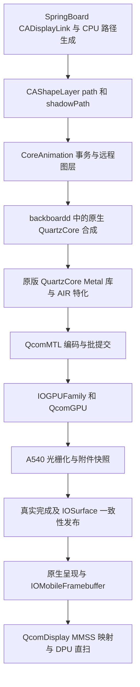

# GPU 驱动进度与 iOS 18 Hello 动画静态分析

分析日期：2026-10-18，America/Los_Angeles。范围为本地驱动源码、iOS 18.7.10 22H374 arm64 原版二进制及项目已有采集记录；本次没有连接设备、运行真机测试、改动驱动或构建启动镜像。

**主要结论：Hello 的动态矢量路径和阴影不断产生新的合成工作，当前 A540 后端又把附件读取实现为逐图元背景快照，叠加索引绘制排空、快照作业串行、逐作业建表及 CPU 等待呈现，造成远高于简单位移动画的成本。** 白条约 30 fps 只证明较轻的原生合成路径可持续工作，尚不能证明 Hello 路径接近 60 fps。静态分析能确定这些放大工作量和限制流水线的机制；各机制对最终掉帧的占比仍需独立计时，本次不把推断写成实测根因百分比。

## 驱动进度与基准版本

主要历史比较基准采用已留存完整结果的 GPU **1.109.0**、Metal **0.85.0**、Display **1.0.13**，对应项目 round115；另保留 GPU1.110/诊断 ABI5 的 wrapper 与资源计时。此次补充读取的源码已为 **GPU1.113 / Metal0.86 / Display1.0.13**，横向裁剪、混批和 word32 的状态在新增章节分别说明。新增计时或候选构建不等同于优化收益，交接 JSON 中尚未同步的版本和 UUID 字段也不作为独立启动身份依据。

| 层次 | 已有证据支持的进度 | 当前边界 |
| --- | --- | --- |
| EFI 与 A540 | 固件、ZAP、SMMU 交接、原生 CP 提交、真实 timestamp 和完成回收已通 | 仍是工程受限实现，不能视为完整 Apple GPU 驱动 |
| IOGPU 与内存 | 原生 buffer、线性 IOSurface、任务归属、私有页表、RO 权限、异步通知及有界队列已通 | 每批建立和退休私有地址空间；索引与背景读取负载不能充分利用异步窗口 |
| Metal 与编译器 | 系统插件、原版 Metal 基类、QuartzCore AIR 特化、Render/Compute、必要纹理和同步路径已通 | MSL/AIR 子集，tile pipeline 等能力缺失；编译器和资源管理还有 CPU 成本 |
| 原生 UI | 在任何诊断动画之前，合成器已有 1627 笔 Render 和 484 笔 Compute 完成，失败 0 | 类型计数可以重叠；不能据此认定 SpringBoard 的几何、布局和所有操作都在 GPU 上执行 |
| 显示 | GPU 生成的 IOSurface 可以经显示 IOMapper 交给 DPU 直接扫描 | GPU 内部背景快照仍存在；显示共享 GPU fence 尚未接通 |
| 正确性与性能 | 已有同步、blit、CA 像素、pattern 等回归结果；早期闪烁与资源生命周期问题已有修正 | Welcome 流畅度目标仍未完成，白条也约为 30 fps |

GPU 1.95 之后已做 scratch 缓存、页表写入/查表优化、有界 draw 批提交、提交辅助函数修正、2D 背景复制、IB 与索引缓存、实际时钟分频修正和重复健康检查削减。已有结果说明这些减少了成本，但没有消除当前架构中的工作量放大和等待边界。

部分 [GPU README](/home/xxiao/Projects/MI6_iOS/docs/gpu/README.md:17)、[Metal 文档](/home/xxiao/Projects/MI6_iOS/docs/gpu/metal.md:1) 的开头仍是较早版本状态；应结合 [交接记录](/home/xxiao/Projects/MI6_iOS/docs/gpu/ui-render-handoff.json:1) 和对应版本的原始证据阅读。旧的“系统 UI 尚无 GPU 绘制”不适用于上述基准。

## SpringBoard 与 Setup 的 Hello 路径

### 开机多语言 Hello

从原版 dyld cache 的 Objective-C 元数据可确认以下层次：

```text
SpringBoard / CoverSheet
  SBDashBoardSetupController
  SBDashBoardSetupViewController
    语言轮换和组件循环
    _updateDisplayedStrings
  SBDashBoardSetupView
    setTitleString:forLanguage:
    _createDisplayLink
    _onDisplayLink:
    _animateCursiveForTimePassed
  SBCursiveTextView
    loadText:pointSize:
    setTime:
  SBCursiveTextPath
    pathForTime:
    pathForFraction:calculateLength:
  CAShapeLayer
    setPath:
    setShadowPath:
```

关键原版地址及行为：

| 方法 | 原版地址 | 确认的行为 |
| --- | --- | --- |
| SBDashBoardSetupViewController 的语言循环 | `0x1d2682f68` | 增加当前语言/字符串索引并处理轮换顺序 |
| SBDashBoardSetupView 的 setTitleString:forLanguage: | `0x1d2beef70` | 检查 CursiveHello 功能分支、加载对应语言的路径、设置起始时间及持续时间、创建 display link |
| _createDisplayLink | `0x1d2bf318c` | 创建原生 CADisplayLink，设置 frame rate range 为 80/120/120，并设置 high frame rate reason |
| _animateCursiveForTimePassed | `0x1d2bf32b0` | 取当前时间减起始时间，调用 cursiveTextView 的 setTime:；超过持续时间后移除 display link |
| SBCursiveTextView 的 configure | `0x1d2c5dd64` | 创建 CAShapeLayer，设置 shadowRadius=1、shadowOpacity=0.1、shadowOffset=(0,1) |
| SBCursiveTextView 的 setTime: | `0x1d2c5df34` | 生成路径、进行 CGPath 变换、同时设置 path 与 shadowPath，随后释放临时路径 |
| SBCursiveTextPath 的 pathForFraction:calculateLength: | `0x1d263f154` | CPU 侧遍历笔画与 Bézier 片段，计算采样、法线、权重，生成轮廓路径 |
| SBCursiveTextPath 的默认初始化 | `0x1d263e664` | resolution 参数为 40 |

这里的 80/120/120 是请求范围，不代表屏幕实际达到 120 Hz，也不是硬编码的低帧率限制。已有另一轮活跃 CADisplayLink 探针达到 60 Hz；这仍不能替代 SpringBoard 自身回调的实际频率。

从原版 System 镜像重新读取的英文 `CursiveHello.plist` 含 **2 条笔画、34 段 Bézier**。按 resolution=40，完整遍历的采样循环上界约为 34×41=1394 次；动画早期会按当前进度提前停止。这不是 GPU 三角形数或逐帧实测次数。资源名中的 Macintosh 3D 也不能作为采用 SceneKit 或 3D 渲染的证据。

路径对象缓存了笔画数据，但 `pathForFraction:` 内的临时采样容器、路径轮廓和变换路径会随更新重建。因此 Hello 不能仅通过移动一张已经画好的纹理完成。路径改变也使阴影路径失效，需要重新处理其显示内容；阴影具体使用多少离屏 pass，尚不能由这段代码单独确定。

### Setup.app 内的不同 Hello 内容

Setup.app 有相似但独立的实现：

- `BuddyFinishedCursiveChildWelcomeView`：`_createDisplayLink` 在 `0x100129564`，`_animateCursiveForTimePassed` 在 `0x10012975c`。
- `BuddyCursiveTextView setTime:` 在 `0x1000820ac`，明确调用 `pathForTime:`、`CGPathCreateCopyByTransformingPath`、`setPath:` 和 `setShadowPath:`。
- `BuddyCursiveTextPath` 同样默认 resolution=40。
- `BuddyPosedDeviceView _localizedHelloCursiveAssetForDeviceType:` 在 `0x100061f5c`，读取的是 `UIImage imageNamed:@"Cursive Hello ..."`，属于设备示意图资源。

因此，开机多语言问候、Setup 的结束欢迎动画、配对示意图中的 Hello 不能混成一个渲染路径。项目当前开机 Hello 的主要分析对象是 SpringBoard 的 SBDashBoardSetupView。

### 进入系统合成和显示



QuartzCore 二进制中存在 `path_cubic`、`path_rect`、`path_clear`、`path_blit` 等 Metal 路径分支，项目也适配了相应 mask 和附件读取语义。动态曲线路径会比矩形位移产生更复杂的几何、mask、混合和阴影工作；但现有采集没有逐 shader 的 Welcome 直方图，不能断言每帧必定执行全部这些分支或给出固定 pass 数。

## 问候淡入淡出与底部提示动画的补充分析

本节继续只读取本地原版二进制、驱动源码和已经存在的记录，不产生新的真机测试。动画属性和常量已从原版 SpringBoard 与 SpringBoardUIServices 的 dyld cache 核对，详细地址、反编译、关键帧数组和原始机器码比较见 [动画补充证据](/home/xxiao/Projects/MI6_iOS/docs/gpu/welcome-static-animation-evidence.json:1)。

### 问候文字的淡入淡出

`SBDashBoardSetupView _animateView:toActive:withDispatchGroup:` 位于 `0x1d2bf2390`，对传入 view 的 layer 创建 **CAKeyframeAnimation(opacity)**：

| 参数 | 原版值 |
| --- | --- |
| keyTimes | [0.03, 0.26, 0.75, 0.98] |
| values | [当前 layer.opacity, 1, 1, 0] |
| calculationMode | linear |
| duration | 本轮 _customDelayDuration，记为 D |
| 添加动画后的模型 opacity | 0 |
| 正常动画标识 | SBDashBoardSetupNormalAnimation-opacity |

`animateComponents:toActive:withCompletion:` 的问候组件分支同时处理 titleLabel 和 cursiveTextView；CursiveHello 分支还立即按当前时间更新笔画，并启动 display link。这样，笔画形状与整层透明度是两套叠加的动画。

以 D=4 秒、起始 opacity=0 的一轮为例，0.12–1.04 秒渐显，1.04–3.00 秒保持，3.00–3.92 秒渐隐。D=4 是说明关键帧比例的例子；实际 D 由路径持续时间决定，CursiveHello 分支使用 max(path.duration+1,4)。起始透明度取当前模型属性，首轮或中断恢复不一定严格从 0 开始。

**淡出期间也不能直接认为笔画生成已经停止。** 原版 `_animateCursiveForTimePassed` 每次先调用 setTime:，再判断 elapsed 是否超过 D 并移除 display link；它没有在笔画已经写完时跳过该调用。因而路径完成后的停留/淡出阶段仍可能反复进行 CPU 路径生成和属性设置。是否每次都让合成器重建相同 mask，要看 QuartzCore 的路径去重和缓存行为，不能只由 setter 调用断言。

当组件被取消或切换到非 active 状态时，`_addResetAnimationForKeyPath:onLayer:dispatchGroup:` 从 presentationLayer 读取正在显示的值，创建约 **0.25 秒 CABasicAnimation** 过渡到当时的模型值。这个恢复分支和正常淡入淡出不同，不能将其中一次短过渡当作整轮 Hello 的固定动画时长。

### 按 HOME 提示的径向渐变与淡出

HOME 分支的入口是 `_animateHomeButtonCallToActionToActive:withDispatchGroup:`（`0x1d2bf25a0`），目标对象为 **SBUICallToActionLabel**，实现位于 SpringBoardUIServices，不是简单的普通 UILabel。

该对象创建径向 CAGradientLayer，使用白色到透明的颜色，startPoint=(0.5,0.5)、endPoint=(1,1)，并将其设置为内部文字 layer 的 **mask**。常规从隐藏状态进入显示时，SpringBoard 调用 `fadeInImmediately:YES completion:`，进入约 **0.6 秒**的 CAAnimationGroup：

| 子动画 | from | to |
| --- | --- | --- |
| transform.scale.xy | 0 | 1 |
| locations | [0,1] | [0.5,0.5] |

两条子动画使用控制点 (0.05,0,0.15,1) 的 timing function。视觉上是由径向渐变遮罩展开文字；不能简单归类成整段文字匀速增加 alpha，也不能把这段代码描述成一直运行的横向扫光。

随后 SpringBoard 的 dispatch timer 在 **D−1 秒**触发，调用 `fadeOutWithDuration:1 completion:`。该方法通过 UIView 动画改变内部 label.alpha，在最后 **1 秒**淡出。取消 active 状态时会取消 timer，并走 duration=0 的淡出/清理分支。

类里还存在延迟 4 秒启动渐变的非 immediately 分支，但上述常规 SpringBoard 调用传入 YES，不能把那 4 秒当成每轮 HOME 提示的必然延迟或卡顿。

文字/语言变化走 `setText:forLanguage:animated:` 与 attributed text 更新；它与稳定文字上的 mask 动画应分开。当前没有证据表明 HOME 渐显的每一帧都会重新排版或重画所有字形。另一方面，稳定字形也不意味着可以只翻转同一张最终屏幕图：动态 mask 和透明度仍要求输出新的合成结果。

### 无 HOME 手势分支与底部位移

`_animateHomeAffordanceCallToActionToActive:withDispatchGroup:`（`0x1d2bf28e0`）对提示容器创建两条关键帧动画，beginTime=CACurrentMediaTime()+1，duration=D：

| 属性 | keyTimes | values |
| --- | --- | --- |
| opacity | [0,0.2,0.5,0.72,1] | [0,0.8,1,0,0] |
| position.y，additive | [0,0.065,0.16,0.6,1] | [0,−16,−30,−33,−33] |

对应的 home affordance 指示元素还有另一条 additive position.y 动画，keyTimes=[0,0.04,0.16,0.6,1]，values=[0,−5,−15,−2,0]。这些是相对原位置的 layer 坐标偏移，不能直接当作实屏物理像素。

因此底部提示有 HOME 与 home affordance 两条分支；当前画面如果实际显示“按 HOME”，应优先对应 SBUICallToActionLabel 路径，不把手势分支的 −33 位移套到 HOME 文字上。

### 多组件如何共同影响一轮动画

问候、底部提示及其他选中的组件通过 dispatch group 汇合。`animationDidStop:finished:` 读取动画携带的 group 并释放对应完成点；HOME 提示也通过渐变完成和淡出完成回调释放其完成点。组完成后，控制器增加语言索引、rebuildAppearance，再启动下一轮组件动画。

这会带来两个不同层次的卡顿表现：

- **呈现不均匀**：合成提交或显示晚了，opacity、mask 和 position 按原时间轴采样到较后的值，中间状态看起来被跳过。手写路径也按 elapsed time 推进，下一次成功显示时可能一下多出一截笔画。
- **轮换迟到**：客户端主线程或动画完成回调迟到，可能延后语言切换及下一轮启动。dispatch group 并不等同于 GPU/显示 fence，不能将其完成直接当作实屏已显示。

问候正在写、文字正在淡、HOME 渐变正在展开，可以在同一帧同时存在。底部效果自身即使更轻，也会与较重的路径和阴影合成争用同一提交队列、资源及显示机会。如果主文字与底部提示一起跳帧，共享链路是应优先检查的对象；如果只有 HOME 渐变异常而其他元素平滑，则需要另外审计 gradient/mask、文字缓存或该对象的时序。以上是定位依据，不是本次新增的动态观测。

## 这些卡顿对应 GPU 驱动哪些未完成部分

补充分析读取时，源码已经推进到 **GPU1.113 / Metal0.86 / Display1.0.13**。以下区分“尚无高效实现”“已经实现但验证未闭合”和“已经验证但收益有限”，避免把前一版的待办继续写成完全缺失。

| 未完成或尚待闭合的部分 | 当前具体状态 | 对上述动画的关系 |
| --- | --- | --- |
| 高效的附件读取与混合路径 | A540 仍通过逐图元背景快照实现 framebuffer fetch，尚无经过验证、可普遍替代它的片上读取/等价混合路径 | 对实际选中 framebuffer-read 管线的路径、mask 或复杂混合，复制与同步成本会放大；已有 Welcome 工作量直接支持其重要性 |
| 充分流水化的依赖和准入调度 | 索引绘制前仍排空 nativeJobs；framebuffer 作业也受已有快照/IB 存活限制 | 较重的笔画任务可阻塞随后较轻的透明度、渐变遮罩或位置更新；异步容量增大本身不能消除这些边界 |
| 更少批次的跨类型提交 | Metal0.86 已加入受条件限制的 Draw+Dispatch 混批；后续 indexed draw、内建 blit 及依赖仍形成边界 | 可减少复杂 mask/路径操作列表的逐批成本，但现有验证尚不能宣布批量合并效果完整通过 |
| 更低开销的地址空间和资源生命周期 | 仍逐作业建立/发布/退休私有页表，执行实际物理页核对与 ASID/TLBSYNC；已有池仅覆盖部分资源 | GPU 很快的 opacity/position 操作也可能支付毫秒级固定成本；多个 pass/批次会重复支付 |
| 原生 GPU 完成到显示的 fence 衔接 | 尚无显示端直接等待的 A540 surface fence；Metal 仍在完成消费和一致性发布后调用原生 present | 直接关系所有元素的帧间隔与错过显示机会，DPU 直扫并没有补齐这个同步环节 |
| 更直接的完成唤醒 | 当前用户态仍有约 1 ms 完成消费与约 2 ms 背压重试调度 | 为串行的小批次增加唤醒延迟；不能仅凭这两个常量推断全部帧率损失 |

**横向裁剪已经不应再列成“尚未实现”。** GPU1.111 已加入按 scissor.x/width 裁剪的 2D 快照路径，并已有原图/guards 验证；原有 Welcome 记录中实际复制量减少约 **4.865%**，仍有约 **7.98 GB** payload，实显间隔中位数约 **100 ms**。它按 draw scissor 裁剪，仍不是按每个图元的实际笔画包围盒裁剪，也没有去掉逐图元快照顺序。

**混批也不是完全缺失。** GPU1.112/Metal0.86 的现有记录显示 compute→compute→render 的像素及 guards 通过，但该新增用例因立即读取的统计计数未增长而 status=1，合批数量证据尚未闭合。GPU1.113 还有 word32 复制候选源码和离线构建；本报告没有其新的硬件像素或性能结论，不能将“四倍减少逻辑 texel 数”写成四倍提速。

还必须保留一个条件：**alpha 动画不自动等于 framebuffer fetch。** 单纯 opacity 可以走普通纹理采样和固定功能混合。只有实际 fragment program 带 framebufferMask 时，才进入上述快照路径；目前没有逐元素、逐 shader 的实测归因，不能说每一帧 HOME 淡出都单独复制了全屏背景。但它仍会受同一合成队列中其他重负载和呈现等待的影响。

当前最直接相关的是附件读取、有效并行度、逐批固定成本和显示同步这几部分。更完整的 Metal family、更多格式、通用 imageblock 等兼容能力仍有缺口，但现有证据不足以将这几类缺失直接定为当前淡入淡出或 HOME 提示卡顿的根因。CPU 侧 Bézier/CGPath 与 UIKit/CoreAnimation 事务开销也不属于“GPU 驱动未完成”本身，应单独计时。

## 为什么自测白条更流畅

[displayctl 的 layerTest](/home/xxiao/Projects/MI6_iOS/tools/displayctl/displayctl.mm:624) 创建全屏不透明红色 root 和白色 bar，只提交一次 `CABasicAnimation(position.x)`，之后让原生合成器推进动画。它没有按每个 display link 重建曲线和阴影。

它还使用 displayable 远程 context 和 ProgressUI 的默认层级。全屏 opaque root 给合成器提供了剔除其下图层的机会；实际剔除了多少底层 Welcome 工作没有单独测量。因此即便最终使用同一套 GPU/显示驱动，也不是同负载对照。

| 项目 | 自测白条 | SpringBoard Hello |
| --- | --- | --- |
| 动画生产 | 一次提交 CABasicAnimation，合成端推进位置 | 客户端 display link 按时间反复更新路径 |
| 几何 | 简单矩形 | Bézier 采样生成的动态轮廓 |
| 内容失效 | 主要为位置变化 | path、shadowPath 随笔画更新 |
| 合成需求 | 不透明背景和简单颜色层 | 抗锯齿、路径 mask、阴影、语言/组件切换及其他 UI |
| 当前后端代价 | 较少 GPU 工作，仍有提交固定成本 | 附件读取和串行边界放大复杂内容的代价 |

已有 GPU1.109 同一启动记录如下。数值来自旧采集，本次只读取和复核：

| 指标 | Welcome 记录窗口 | 白条有效 20 秒窗口 |
| --- | ---: | ---: |
| 实际 displayed 样本数 | 499 | 601 |
| 窗口跨度 | 81.633 s | 20.020 s |
| 记录的实显更新率 | 6.101 fps | 29.970 fps |
| 实显间隔 p50 | 99.943 ms | 33.335 ms |
| 实显间隔 p95 | 299.896 ms | 33.459 ms |
| 原生准入计时样本数 | 2160 | 841 |
| GPU 执行区间均值 | 11.308 ms/作业 | 0.488 ms/作业 |
| CPU 准入均值 | 9.594 ms/作业 | 7.951 ms/作业 |
| 其中地址空间阶段 | 5.246 ms/作业 | 4.427 ms/作业 |
| 回收阶段均值 | 1.628 ms/作业 | 1.568 ms/作业 |

Welcome 的记录含 9.118 秒无新显示帧间隔，且本身有语言循环、静态停留和 display link 停止逻辑，**6.101 是整段记录更新率，不能作为全程持续书写的精确帧率**。p50 约 100 ms 表示记录中典型新帧间隔仍明显高于白条；9 秒间隔的具体原因也不能仅凭统计认定为 GPU 卡死。

两个窗口的 GPU 执行区间均值相差约 **23.17 倍**。该区间含快照、绘制、barrier 和地址空间切换，不是单独 fragment shader 的执行时间。CPU 子阶段已包含在准入总值内，CPU 与 GPU 也会重叠；不能把表格所有时间相加推导一帧耗时。

Welcome 窗口已有约 11.75 GB 的背景快照 payload / 2488 个快照图元累计量。payload 只计一份复制大小，不能当成实测 DDR 总流量；它证明直扫之前仍有大量 GPU 内部复制。

### 最新资源计时的补充记录

收尾时已有的 GPU1.110 阶段文件经本地 UART 文件解析复核，Welcome 记录为 316 个显示样本、6.602 次更新/秒、p50 100.030 ms；采集时最后一帧已过去 42.873 秒，因此该历史更新率不表示采集时动画仍在活动。白条单独扣除既有样本后为 602 帧、29.751 fps、p50 33.340 ms。

| 新计时范围 | Welcome 启动累计 | 白条窗口增量 |
| --- | ---: | ---: |
| 内部准入 | 1367 次，9.605 ms/次 | 715 次，8.199 ms/次 |
| 完整 Family submit wrapper | 1367 次，11.567 ms/次 | 715 次，10.140 ms/次 |
| 资源创建 wrapper | 660 次，5.066 ms/次 | 46 次，5.324 ms/次 |
| 资源删除 wrapper | 658 次，2.190 ms/次 | 75 次，2.269 ms/次 |
| 原生资源 free | 658 次，2.170 ms/次 | 75 次，2.247 ms/次 |

完整 wrapper 比内部准入多约 1.94–1.96 ms/调用，说明旧内部计时确实没有覆盖所有准入相关工作。该 timer 从共享 GPU gate 内开始，仍不覆盖等待进入 gate、用户态 transport lock 及完整 IPC 墙钟。free 嵌套在删除路径内，不能把二者相加；这些按操作累计的范围也不能直接当作逐帧独占 CPU 时间。

白条窗口资源创建和删除的累计时间分别约 245 ms 和 170 ms，明显不足以单独解释约 20 秒窗口内持续停留在 30 fps。Welcome 启动涉及更多资源更替，值得继续细分，但尚不能将主因归结为资源 free。这组新记录支持原有结构性判断，没有证明 60 fps，也不能与旧窗口做严格同负载回归比较。

## 已确定的驱动成本与串行边界

### 附件读取逐图元复制背景

[AdrenoPipeline.h](/home/xxiao/Projects/MI6_iOS/drivers/gpu/QcomGPU/AdrenoPipeline.h:546) 在 `framebufferMask != 0` 时逐 instance、逐 primitive 执行：

1. 完成此前颜色/深度写入及缓存同步。
2. 为当前图元复制其读取的颜色附件。
3. 完成复制、同步缓存并重新发出光栅状态。
4. 绘制当前图元，再处理下一个图元。

这一顺序保留同一 draw 内重叠图元对先前结果的可见性。直接改成“每个 draw 只复制一次”会破坏 source-over 等重叠混合。

GPU1.109 基准的 [framebufferCopyRegion](/home/xxiao/Projects/MI6_iOS/drivers/gpu/QcomGPU/AdrenoPipeline.h:42) 只按 scissor 的纵向区间裁剪，并向 2×2 fragment quad 边界扩展，复制这些行的完整 pitch。GPU1.111 起另有 framebufferScissor2DRegions，符合约束时使用 scissor.x/width 缩小横向复制；它仍不按当前图元的实际包围盒进一步缩小。

例如 pitch=4352、高度=1920 的全屏 scissor，**每个读取背景的图元**仍会产生 8,355,840 字节复制 payload。实际 Hello 的每个 draw 不一定全屏，但窄笔画本身也不会自动令 draw 的 scissor 缩成窄区域。这解释了可见笔画面积小而后台工作量大的可能性。

已有 2D 路径加快了复制的大部分字节，却保留逐图元顺序、compute 尾部、flush/wait 和状态恢复。因此“2D 覆盖率高”不能等同于“快照成本已经消除”。

### 异步窗口被索引与快照条件收窄

[GPUNativeCompletion.h](/home/xxiao/Projects/MI6_iOS/drivers/include/GPUNativeCompletion.h:9) 的实际条件是：

```cpp
pending >= MaxJobs ||
(indexed && pending) ||
(framebuffer && (snapshotBytes || ibBytes))
```

这意味着有任何 pending 作业时，索引绘制会延后；还有快照或相关 IB 存活时，后续 framebuffer 作业会延后。检查在 Family token/fence 分配前进行，避免把暂时压力记成终止错误。

[QcomMTL](/home/xxiao/Projects/MI6_iOS/drivers/gpu/QcomMTL/QcomMTL.mm:2994) 也在索引绘制前检查整个 device 的 `_nativeJobs`，要求此前作业退休后才让内核进行索引 CPU 快照。内核另外保留实际 backing/物理别名冲突检查。这些是正确性措施，但使“最多 16 笔异步作业”无法直接转化成 Hello 的 16 笔流水线。

Metal0.85 基准只把相邻 draw 合成同一批；Metal0.86 已加入受约束的 Draw+Dispatch 混批。内建 clear/blit、event、fence、barrier、任务归属及索引生产依赖仍可能形成边界。复杂路径多次经过这些边界，就会重复支付准入、建表和完成等待成本；新混批的验证状态见补充章节。

### 每个原生作业重复建立和退休地址空间

[createAddressSpace](/home/xxiao/Projects/MI6_iOS/drivers/gpu/QcomGPU/QcomGPUMapper.cpp:277) 为每个作业创建私有树、分配 ASID、映射相关完整 backing，逐页比较真实 retained translation 与物理页，发布后做 TLB 同步。完成后还要证明已切回内核树，再同步 ASID 和释放私有表。

页表游标和 DMA/IB/索引缓存已经减少了部分工作，但没有取消这套逐作业成本。Welcome 的复杂操作列表和较多批次会反复支付它。已有均值中的地址空间阶段仍为 5.246 ms/作业；白条本身也有 4.427 ms/作业，明显高于其约 0.488 ms 的 GPU 执行区间。

### 完成通知和呈现仍依赖 CPU

[QcomMTL 的完成调度](/home/xxiao/Projects/MI6_iOS/drivers/gpu/QcomMTL/QcomMTL.mm:2809) 通过约 1 ms dispatch_after 消费原生完成通知；准入压力重试另有约 2 ms 延后。它们是附加延迟来源，不是已证明的全部掉帧原因。

[呈现路径](/home/xxiao/Projects/MI6_iOS/drivers/gpu/QcomMTL/QcomMTL.mm:3463) 在真实 GPU token、资源一致性发布和回收完成后才调用原生 drawable present，且有 presentation barrier。当前没有导入显示端可直接等待的 A540 surface fence，所以渲染、退休、CPU 通知、原生 swap 的时序容易跨越下一次显示机会。

[QcomDisplay](/home/xxiao/Projects/MI6_iOS/drivers/display/QcomDisplay/QcomDisplay.cpp:803) 等原生 ready mask/fence 后准备 IOSurface，交给 DPU 扫描，并只在真实显示完成时记录样本。直扫避免末端每帧 CPU 拷贝，但不会消除此前的 GPU 背景快照或 CPU 提交等待。

## 排除过度归因与优化顺序

**不能继续采用的旧解释：**

- Welcome 已有真实 Render/Compute 完成，不能再笼统说它完全使用软件绘制。CPU 路径生成与 GPU 最终合成可以同时存在。
- 当前基准实际 CP 约 596 MHz；早期约 298 MHz 的分频问题已修正，不能把它当作当前唯一原因。
- 原生 display link 已有 60 Hz 记录，SpringBoard 又明确请求高刷新范围，源码没有显示 Hello 主动限制为几 fps。不过 SpringBoard 的实际回调节奏仍未单独覆盖。
- round114 和 round115 的性能记录已显示“减少部分 CPU 开销，白条仍约 30 fps”；不能承诺再削减一个阶段就必然达到 60 fps。
- AIR 按函数常量和缓存键保存已编译程序；首次编译或缓存生命周期可能影响启动，但没有证据表明 Hello 每帧重编译 shader。
- 无新帧可能来自动画停留、客户端没有提交、依赖等待或显示时序；不能只由一张静帧、VBL 计数或 GPU 作业数判定。

**优先继续的方向：**

| 优先级 | 方向 | 静态依据与必须保持的语义 |
| --- | --- | --- |
| 1 | 细分完整 Family submit 和资源生命周期中的耗时 | 1.110/ABI5 已补上 wrapper/free，显示外层约另有 2 ms/调用；继续区分健康检查、Family、实际分配和 DMA 映射，避免只依据单次 free 均值选择优化 |
| 1 | 进一步减少附件快照范围和不必要的状态往返 | 横向 scissor 裁剪已在 GPU1.111 实现并有记录；仍需研究图元范围、逐图元同步和更直接的读取路径，保持 helper lanes、边界、格式和 MSAA 语义 |
| 2 | 对可证明等价的混合使用更直接的硬件路径 | 简单 source-over 的固定功能混合或经过验证的 A5xx 局部附件读取值得研究；复杂 clip、颜色矩阵、half 舍入不能一概替换 |
| 2 | 细化索引与快照准入依赖，扩大有效批次 | 目前排空范围较保守；需按真实生产者和物理别名证明索引可快照，不能让 CPU 读发生在 GPU 生产之前 |
| 2 | 复用已安全退休的页表页及减少重复映射工作 | 保留逐页物理地址检查、清零、ASID/TLBSYNC、失败隔离和内存预算；实际收益取决于建表阶段细分 |
| 3 | 接通显示共享 fence 和更直接的完成唤醒 | 缩短退休到呈现的 CPU 往返；不能提前发布 Scheduled 或伪造 GPU/显示完成 |

## 后续离线优化：GPU1.113

用户报告设备电量耗尽后，本阶段只读取历史采集、修改源码和构建镜像，没有启动设备。上述原版框架分析仍适用；当前历史实测基准已推进到 round119 的 GPU1.112 / Metal0.86。

round119 在诊断图层提交前记录了 289 个实显样本，跨度 43.944 秒，中位间隔 100.008 ms、p95 300.117 ms。整段更新率 6.554/s 包含停留，采集时最后一帧已有 46.022 秒，不能当作当时持续书写的帧率。实际 GPU 区间均值约 10.939 ms/作业，CP 核心均值 595.989 MHz；地址空间阶段约 5.200 ms/作业，完整 Family wrapper 约 11.620 ms/调用。这些范围有嵌套、CPU/GPU 有重叠，不能相加推导逐帧耗时。

横向 scissor 裁剪已在 GPU1.111 实现并经过实机图案回归。round119 的实际背景复制 payload 为 6,555,451,648 字节，相对未裁剪理论量减少 4.724%；其中约 98.065% 走 2D 路径。横向裁剪没有显著缩小这个 Welcome 窗口的复制量，逐图元快照仍需继续优化。

GPU1.113 将可信、对齐的多行 2D 原始复制从 R8_UNORM 改为 R32_UINT 视图，保持字节地址、pitch、实际 slice、复制范围和每图元同步顺序，只将横坐标和宽度改为四字节 texel 单位。整数格式避免浮点和 UNORM 转换；单行 buffer 形式、至少 64 KiB compute 尾部及 MSAA 回退保留。依据是项目固定 Mesa24.3.4 的 `fd5_blitter.c` 普通同格式复制和 `fd5_format.c` 的 R32_UINT 支持。`gpu-fb2d-word32=0` 可在同一内核及 HFS 上恢复旧形式。

普通及 ASan/UBSan 主机测试通过，回放实际 PM4 并验证非均匀数据、重叠图元、helper lanes、行 padding、R8/RG8/RGBA8 及窄 scissor。74 个 Kext、23 个本地二进制哈希、HFS 全部 12 个文件和三份桥接镜像均已离线核对。**这些测试没有证明硬件位精确或帧率改善；四倍更少的逻辑 texel 不等于四倍复制速度。**

Metal0.86 的混合批提交在 round119 首个回归中已得到正确像素，但读取周期统计快照时取得旧计数而失败，后两个阶段未执行。新 CLI 在实际完成后等待统计更新，并继续要求精确作业数；旧失败记录保留，批次数仍待实机验证。不能为扩大批次而跨过 CPU 冻结 blit 参数或 GPU 生成索引的依赖边界。

下一步地址空间分析需区分硬件健康检查、表页分配/清零、逐页物理映射核对和 publish/TLBSYNC，现有 5.2 ms 总计不足以证明分配占主导。GPU 区间还需拆分背景 2D 复制、compute 尾部、光栅/着色和已有同步。源码和产物收据见 [GPU1.113 收据](/home/xxiao/Projects/MI6_iOS/build/gpu-runtime/ui-copy-word32-source.json)，分析边界见 [离线开销审计](/home/xxiao/Projects/MI6_iOS/build/gpu-runtime/ui-copy-word32/offline-bottleneck-audit.json)。复杂 Welcome 约 60 fps 的目标尚未完成。
| 3 | 单独覆盖 Hello 客户端生成与事务提交 | CPU Bézier、CGPath、shadowPath、主线程调度和 CA 提交尚无完整计时，不能把所有慢帧都归到 GPU 内核 |

逐图元背景快照及两层准入条件是当前最明确的结构性成本；已有 wrapper/资源计时进一步缩小了剩余 CPU 成本的范围。单纯继续升频、扩大队列容量，或仅重跑白条，都不足以回答 Hello 的瓶颈。

## 按四项顺序推进：GPU1.114 离线实验

用户指定先处理 framebuffer fetch，再推进提交流水化、地址空间与批提交、GPU 到显示 fence。本轮保持设备离线，前三份 GPU1.113 镜像和收据仍保留；新候选为 GPU1.114，Metal0.86、显示驱动、GPU 时钟策略和冻结 Kext 集合沿用基线。

第一项新增默认关闭的逐图元原位读取实验：单采样、单颜色附件的 RGBA/BGRA8 UNorm/sRGB 三角形可以绑定自己的目标纹理，读取当前 fragment 对应像素，然后输出该像素。每个图元及 instance 仍分别绘制，保留颜色/UCHE flush 的真实 timestamp、匹配等待和下一次绘制前的 UCHE 失效。这样可以省去背景复制及复制后的模式切换，尚未合并相互重叠的图元。

依据是 [Khronos ARB_texture_barrier](https://registry.khronos.org/OpenGL/extensions/ARB/ARB_texture_barrier.txt) 的受限同像素读写语义，以及固定 Mesa24.3.4 中 A5xx 的 texture barrier、sysmem 收尾与缓存失效实现。这不代表 A540 有 A6xx 式 coherent framebuffer fetch：固定 Mesa 的 A5xx `PIPE_CAP_FBFETCH` 为零，手写 PM4 序列仍必须经过实机验证。MSAA、MRT、线和 R8/RG8 继续用快照；原生物理别名检查、私有页表、索引快照、一致性与显示完成顺序均保留。

`gpu-fb-fetch=0` 为默认快照路径，`1` 仅供有管理权限的非合成器诊断，`2` 为全局实验。GPU1.114 的 word32 默认关闭，用已验证的 R8 复制形式作为回退，以单独考察本次原位读取。分别统计原位图元和实际快照图元，只有成功且一致性发布完成的真实 GPU 作业才计数。

主机测试回放实际 PM4，核对每次绘制前的颜色/UCHE 等待和失效、原位描述符地址、没有生成复制命令、四种颜色格式及 R8 回退。384 个图元跨 IB、实例参数、下一笔 draw 和 IB 空间不足回退也通过；ASan/UBSan 通过。**尚无新候选的硬件像素、缓存可见性或帧率结果。** 当前仍保留完整快照 scratch 分配和原有准入限制，因此还没有证明充分流水化或地址空间成本下降。

| 顺序 | 后续实施与验证边界 |
| --- | --- |
| 高效 framebuffer fetch | 先在诊断权限下验证非均匀图案、重叠、实例、索引 strip/restart、quad/缓存边界、RGBA/BGRA/sRGB 与 guards；通过后再测原生复杂 UI 的真实显示间隔 |
| 充分流水化的提交调度 | 区分原位读取和实际快照的资源预算；索引 CPU 快照只能在真实 GPU 生产者完成后读取；保留整份操作列表的 Scheduled、FIFO 与失败传播 |
| 低开销的地址空间与批提交 | 在原位读取验证后移除无用快照映射；细分健康检查、分配、逐页验证与 TLB 同步，再决定页表缓存；闭合 mixed-test 的精确作业数验证 |
| GPU 完成到显示的 fence | 核对实际 Family/IOSurface/IOMFB fence ABI，先接可靠完成唤醒，再让显示端等待准确的生产者 fence；保留缓存发布、DPU latch 和表面退休顺序 |

代码与产物身份见 [GPU1.114 收据](/home/xxiao/Projects/MI6_iOS/build/gpu-runtime/ui-fetch-inplace-source.json)，各阶段的源码依据和验证要求见 [有序实施审计](/home/xxiao/Projects/MI6_iOS/build/gpu-runtime/ui-fetch-inplace/ordered-work-audit.json)。这些是继续达到复杂系统 UI 约 60 fps 的步骤，不能据此宣告目标已完成。

## 第二项的 CPU 准入流水化：GPU1.115 / Metal0.87

本轮继续离线推进提交调度。新候选默认关闭；GPU1.114 的 framebuffer fetch 实验仍保留独立开关。GPU1.115 对旧作业使用索引的情况区分读取者和写入者：在原生 Family 分配 token 前，核对所有客户端活跃作业的实际物理 backing 和写集合，允许已完整核对的读／读共享；可能的 GPU 写者仍必须先真实完成并发布一致性。

CPU 索引快照和内建 blit 参数冻结都采用这项检查。缓存同步会作用于整个 root descriptor，因此检查整个 root 的物理重叠，包含索引逻辑范围之外的写入。不同资源 ID、不同 descriptor、只读 view 都不能绕过物理写者检查；无法解释的 pending 引用也会延后。实际提交在 CPU 读之前再次核对，批内 GPU 生产者检查仍保留。

帧缓冲作业可以在预算允许时继续准入：每笔计划覆盖完整 scratch、精确索引快照和最坏 16 MiB IB 链，仍受 16 笔作业、64 MiB framebuffer scratch、64 MiB IB、16 MiB index snapshot 上限约束。延后发生在 token 保留前，重试沿用原 token。Metal0.87 只在内核声明 `IOGPUNativePipelineVersion=1` 时启用新路径；窗口满时也采用有名额释放即可重试的机制，避免总要等全部作业排空。

普通和 ASan/UBSan 测试通过，覆盖读共享、不同物理别名 descriptor 的写者、索引范围外的整 root 缓存冲突、未知 pending 引用、预算边界／溢出、精确 token 重试，以及 16 格窗口在第一笔真实完成后补入一笔而另外 15 笔仍活跃的场景。驱动、Metal 和诊断工具完成交叉构建。

**当前硬件调度器仍逐笔启动 GPU 作业。** 这些改动允许 CPU 编码和建表与旧作业执行重叠，尚未完成多笔 GPU 作业的连续 ring 提交。完整 scratch 映射和逐作业地址空间成本也保留，显示 fence 尚未改动。新增 queued admission、最大准入深度、CPU 读依赖和容量延后计数用于后续定位；它们不能代替实显帧率。

| 准备的对照 | fetch 模式 | `gpu-pipe` |
| --- | ---: | ---: |
| 默认基线 | 0，快照 | 0 |
| 仅 CPU 准入流水化 | 0，快照 | 1 |
| 仅有权限的非合成器 fetch 诊断 | 1 | 0 |
| 全局 fetch 对照 | 2 | 0 |
| fetch 与 CPU 准入流水化组合 | 2 | 1 |

五份镜像使用相同最终内核、Metal0.87 HFS、固件、trust cache 和时钟策略，只改变上述参数。短参数 `gpu-fbf` 与原 `gpu-fb-fetch` 含义相同，用于保持原生 NVRAM 启动参数小于 1024 字节。全部尚未在设备执行，像素正确性、队列深度和实际流畅度均待实机验证。身份和边界见 [GPU1.115 收据](/home/xxiao/Projects/MI6_iOS/build/gpu-runtime/ui-admission-pipeline-source.json) 与 [准入正确性审计](/home/xxiao/Projects/MI6_iOS/build/gpu-runtime/ui-admission-pipeline/correctness-audit.json)。

## 第二项的连续 ring 提交：GPU1.116 / Metal0.87

本轮离线候选进一步允许多笔作业同时留在硬件 ring 中。`gpu-pipe=0` 保留逐笔派发，`1` 为 CPU 准入流水化，`2` 才开启连续 ring 提交；默认仍为 0。Metal0.87 二进制、GPU 596 MHz 策略和 framebuffer fetch 实现沿用上一轮。

原先共享的一组计时位置改为 16 个内核私有槽，每个槽包含 CP 写入的开始／结束序号和该作业的 always-on、core、busy 时间。记录同时绑定引擎 epoch 和非回绕序号；只有真实全局完成时间戳、正确的私有槽标记、页表／ASID 退休及 CPU 缓存同步完成后才能复用。单个槽释放后可以继续提交，后面的作业无需排空。GPU 私有页表仍不能映射这张完成页。

调度器保留队列内顺序和队列间优先级，在容量允许时连续派发。对不同目标和只读共享资源允许重叠；涉及物理别名写入时，仍等待前序资源退休。这里比较的是整个 backing 的实际物理页，不能只比较资源 ID 或索引范围。通用资源缓存准备从准入移到实际派发前，避免后一笔 CPU 编码过程中清理上一笔仍在写入的缓冲区。此修正也应用于模式 0 和 1。

完成处理读取每笔独立计时记录，并按照实际 CP 序号识别已完成作业；原生 end token、IOSurface 发布和资源释放仍按准入 FIFO。看门狗跟踪最早尚未完成的硬件序号，排队中的作业不会提前积累超时。旧页表退休可以发生在下一笔已选中另一张合法页表时，但旧作业真实完成、旧 ASID TLBSYNC 和页表销毁顺序全部保留。

普通与 ASan/UBSan 测试通过，覆盖 16 笔实际 PM4 入队、只释放一格后补入、旧 epoch／复用槽拒绝、最大 256 个 IB 的作业填满 ring 后重试、另一张页表已被选中时退休旧页表，以及前一笔故障阻止后续成功完成。驱动、gpuctl、74 Kext 集合／23 份本地哈希、12 文件 HFS 读回和四份 bridge 产物均已离线校验。

四份镜像分别为 fetch/pipe 的 `0/0`、`0/1`、`0/2`、`2/2`，其最终内核、HFS、固件、trust cache 和时钟策略完全一致，启动参数均为 1022 字节。`QueuedRingJobs` 和 `RingMaxDepth` 只表示提交时尚未被 CPU 观察为完成的序号数量，不代表多个 GPU 引擎同时执行，也不代表显示帧率。`RunObserved` 包含排队和回调延迟；`CachePrepare` 现在位于 `Kick` 内，不能与嵌套时间相加。

**这仍未证明完整系统 UI 达到 60 fps。** 同一共享目标上的写依赖仍经过 CPU 一致性退休；消除这个边界需要明确资源持有和缓存协议。显示前等待、1 ms 完成轮询、完整 scratch 分配和逐作业建表也仍在。下一步继续核对这些依赖边界，并推进指定第三项的地址空间／批提交开销，再处理 GPU 到显示的原生 fence。

原理参考 Apple 对[命令缓冲区提交](https://developer.apple.com/library/archive/documentation/3DDrawing/Conceptual/MTLBestPracticesGuide/CommandBuffers.html)和[资源同步](https://developer.apple.com/documentation/metal/resource-synchronization)的说明；这些公开原则不能替代当前移植的私有 ABI 和非一致性缓存验证。具体身份与边界见 [GPU1.116 收据](/home/xxiao/Projects/MI6_iOS/build/gpu-runtime/ui-ring-pipeline-source.json)和[连续提交审计](/home/xxiao/Projects/MI6_iOS/build/gpu-runtime/ui-ring-pipeline/correctness-audit.json)。设备没电期间没有执行新候选。

## 第三项的无用快照存储移除：GPU1.117 / Metal0.87

原位 framebuffer fetch 在 GPU1.116 中虽然已不发出颜色复制命令，CPU 仍按完整颜色快照分配、清零并建立映射。GPU1.117 将符合原有原位条件的作业缩为 4 KiB 私有 scratch，保留 flush 时间戳和进度单元；没有改变其着色器、逐图元拆分、颜色／UCHE flush、等待或描述符内容。

准入预算、实际分配和 PM4 编码现在共用 `framebufferStoragePlan`。它先执行原有附件／快照布局验证，再决定所需存储。混合批次取各绘制的实际最大需求；R8/RG8、MSAA、MRT、线段和显式 snapshot 路径仍保留完整快照空间。不同模式的权限判断也由同一函数提供。

以 1080×1920 RGBA8、行距 4352 字节为例，旧 scratch 长度为 8,359,936 字节，新纯原位长度为 4,096 字节，少清零和映射 8,355,840 字节、2040 个私有叶页。这些是源码及主机测试验证的逻辑存储数量，**不是耗时、DDR 带宽或帧率测量**；底层 IOKit 分配可能仍按原生页粒度保留物理内存。

普通与 ASan/UBSan 测试验证四种可用颜色格式和 R8 回退，精简与完整存储的 PM4／着色器字节完全相同；384 个图元跨 IB、实例与重试路径也使用真实 4 KiB 参数通过。实际页表构造器验证 1 页与 2041 页映射、每页物理检查、时间戳区域可访问及精简区域末尾不可访问。混合 RGBA8 原位／R8 回退批次需要 8 KiB，不会错误压缩为 4 KiB。

增加 `gpu-fbf=3` 作为全局原位 fetch 的完整 scratch 对照。它与 `gpu-fbf=2` 使用相同绘制路径，仅存储规划不同，便于以后在同一内核下比较分配／映射开销。默认 `gpu-fbf=0` 仍采用快照。新增 scratch bytes／avoided bytes 只累计真实成功且一致完成的作业，不表示峰值内存或显存流量。

本轮没有设备操作。详细地址空间计时、可安全复用的页表池、共享目标的缓存持有协议及显示 fence 仍待推进；不能宣告复杂系统 UI 达到 60 fps。[实现审计](/home/xxiao/Projects/MI6_iOS/build/gpu-runtime/ui-framebuffer-storage/correctness-audit.json)与[地址空间后续分析](/home/xxiao/Projects/MI6_iOS/build/gpu-runtime/ui-framebuffer-storage/address-space-next-audit.json)保留验证范围和历史测量的区别。

## 证据索引与复核范围

- [二进制方法和反编译摘录](/home/xxiao/Projects/MI6_iOS/docs/gpu/welcome-static-binary-evidence.json:1)：SpringBoard 的路径、阴影与循环控制，Setup 的对应实现及静态图片分支。
- [淡入淡出和底部提示的补充证据](/home/xxiao/Projects/MI6_iOS/docs/gpu/welcome-static-animation-evidence.json:1)：opacity、HOME 渐变 mask、home affordance 位移、关键帧数组及回调时序；5 段机器码完整区间与原版 cache 一致。
- [原版 dyld cache 核对](/home/xxiao/Projects/MI6_iOS/docs/gpu/welcome-static-cache-evidence.json:1)：selector 由原始 cache 解码；4 个关键入口各前 64 字节与 IDA 数据一致，保留对应 cache 偏移和摘要，以及控制器方法表。
- [项目状态和历史性能快照](/home/xxiao/Projects/MI6_iOS/docs/gpu/welcome-static-project-evidence.json:1)：源码 SHA256、原版英文笔画资源摘要、已有基准测量完整副本及计算口径。
- [已有系统 UI 加速证据](/home/xxiao/Projects/MI6_iOS/build/gpu-runtime/round-115-ui-acceleration-evidence.json:1) 与 [已有性能记录](/home/xxiao/Projects/MI6_iOS/build/gpu-runtime/ui-admission-stages/performance.json:1)。

重打包分析镜像缺少部分 shared-cache stub island 和外部 selector 字符串，因此原版 selector 单独从本地固件的 dyld cache 读取；不采信反编译器由这些缺失映射推断出的 noreturn 和错误调用原型。上述静态机制、旧测量和候选代码状态分别记录，本次不产生新的设备性能结论。


## 地址空间分段计时与退休页复用：GPU1.118

GPU1.118 / Metal0.87 / Display1.0.13 为私有作业页表增加最多 64 页的有界缓存。`gpu-pipe=3` 在连续 ring 模式 2 上开启该缓存；默认仍为 0。只有真实 GPU 完成、当前 TTBR 已离开该作业、健康检查及旧 ASID TLBSYNC 成功的已提交注册根才能入池。每次重用都校验原始内存描述符的物理段、跨度及 CPU 映射，并完整清零 512 项；所有资源的逐页物理来源、RO/nG/OSH/AF/XN 权限与新 ASID 同步不变。错误清理不入池；失败缓存条目保留，故障 mapper 不释放整个持有图。64 页是逻辑 4 KiB 表页计数，实际 IOBuffer 物理保留可能按系统 16 KiB 粒度。

独立的 `GPUAddressSpaceStatistics` 属性使用版本 1 / 1120 字节，原 `GPUStatistics` 版本 5 / 3216 字节不变。13 个阶段区分锁等待、健康检查、映射、发布、TLB 同步和释放；逐页分配、清零、来源核对按每 64 次建表抽样，未抽样时不读逐页时钟。这些细项嵌套在映射中，不能相加；确定性抽样可能与场景相关，且包含时钟读取开销。不同 IORegistry 属性读取时间也不同，不能按一个精确共同 epoch 合并。

普通主机测试及 ASan/UBSan 均通过，包含实际 PM4 回放：C 真实完成后在 B 仍选中自己的树时执行 C 的 ASID 同步和退休；D 重用已清零的 C 表页，访问自己的目标而不写入 C 的旧目标。还验证 RO 命令、全局 fence 不可映射、缓存容量、坏条目保留与未提交清理。七个开关组合保持相同内核、HFS、固件、trust cache、596 MHz / 968 mV 和四 CPU，NVRAM boot-args 均为 1022 字节。

用户已重新授权本轮真机测试。round120–123 四轮均启动四 CPU，通过混批数量、GPU 生成索引、fence、blit、系统 CA 与 1080×1920 RGBA8 framebuffer 四阶段回归。ring 观测到合成器在途深度 3；这只证明连续提交实际使用，不代表 GPU 并行度或 60 fps。基线建表约 5.43 ms/作业，其中缓冲映射约 4.19 ms、健康检查约 0.87 ms；退休约 1.47 ms，其中健康检查约 0.79 ms、页表释放约 0.67 ms。TLB 同步只有几微秒。其他反馈格式、实际淡入淡出视觉正确性及严格控制组尚未全部验证。

两轮实显间隔中位数分别约 100.09 / 83.50 ms；round121 尾端样本年龄约 28.2 秒，用户指出可能自动熄屏，因此不宣称固定帧率提升百分比。用户还报告动画更新闪烁；两轮均 `fetch=0`，故不能归因于原位 fetch。辅助像素测试通过不代表复杂 UI 视觉验收通过，需继续审查 GPU 写入与 DPU 扫描的 surface 生命周期和 producer fence。

证据见 [本轮记录](/home/xxiao/Projects/MI6_iOS/build/gpu-runtime/ui-as-page-cache/hardware-evidence.json)；实现进度对照见 [优化建议补充](/home/xxiao/Projects/MI6_iOS/docs/gpu/hello-animation-optimization-priorities.md)。混批共用 IB、额外 1 ms 退休延后、真实通知端口以及原生显示 producer fence 仍未完成。


GPU1.118 页表缓存真机对照已完成（round122，fetch0/pipe3）：相对 round121 的 fetch0/pipe2，建表均值约 6.24→5.12 ms/作业，地址空间退休约 1.50→0.83 ms/作业；释放细项由数百微秒降至约 25 µs。快照记录命中 33,139 次、物理分配 1,102 次、缓存 64 页、校验失败 0。场景组合和自动熄屏时机不同，因此这些均值是本轮实测对照，不是每种动画的保证增幅。实显间隔中位数约 83.3 ms。

round123 开启 fetch2/pipe3 组合后，建表均值约 3.21 ms/作业、地址空间退休约 0.80 ms/作业；GPU 执行区间约 6.44 ms/作业，基线约 10.71 ms。实显间隔中位数 66.70 ms，753 次记录覆盖约 67.66 秒，窗口总体约 11.11 次更新/秒，含停留和采集扰动；不能把中位间隔倒数当作整个动画的平均帧率。尚未接近 16.67 ms 的目标。属性快照中合成器 inplace 命中 1602 个图元、反馈快照复制字节为 0、避免 scratch 约 5.52 GB；这些计数仅代表反馈路径，不代表全部 GPU 拷贝或实测 DDR 带宽。CP/always-on 比值约 595.99 MHz，符合固件当前 596 MHz / 968 mV 策略。

同轮还暴露统计快照发布滞后：`timerAction` 按一秒期限更新属性，IRQ 驱动的 `retireJobs` 却不断重置同一个定时器。在持续负载下属性可能迟迟不更新。GPUStatistics 停留在 1323 笔作业，后续内核实时记录已为 3132 笔；各自 GPU 均值为 6.446 / 6.440 ms。解析器已删除跨属性、跨显示窗口的“耗时/显示帧”推算。下一步应提供带时间戳和序号的新鲜快照，避免每帧属性分配，并按同一采样窗口连接 GPU 完成与显示。

用户在当前组合下补充：**文字动画稍微流畅，闪烁主要发生在淡入淡出阶段**。这是未解决的视觉问题；需要分别检查 alpha 合成输出、surface 写入/扫描所有权及 producer fence，不能从简单像素测试推断根因。当前设备保留 round123 实验模式，默认仍 fetch0/pipe0。round121 的窗口后 `scanout-live` 返回 unavailable，未提供图像证明。四轮的六项 GPU 回归均通过，也不等于实际 UI 视觉验收通过。

## 混批 IB 紧凑编码与实时计数：GPU1.119

`gpu-pipe=4` 在模式 3 上开启同批小操作共享 IB。先仅在当前 IB 试编码，禁止试编码时封口和分配后继块；容量不足时恢复命令头、上传尾部、保留空间、IB／border 地址、反馈计数与 flush 序号，然后换块重试。只有重试才允许大 draw 沿原有逐图元路径跨 IB。资源解析、索引／blit CPU 快照和引用保留发生一次，重试不改变已准入的资源集合。原有物理别名检查、只读映射、ASID/TLBSYNC、GPU 完成及显示生命周期约束保留。

冻结 blit 参数现在相对实际当前 IB 定址；此前固定使用首块 `job.ib` 地址，对后续 IB 不成立。重试重新上传冻结内容，保持上传地址随 IB 一起迁移。这个修正同时用于同源控制和候选，未单独证明它与实际淡入淡出闪烁的因果关系。

主机测试中 16 个混合操作从 16 块降为 2 块 IB。完整寄存器／包流比较仅规范化私有地址和额外封口等待，同时检查每个地址所指向的实际 shader 代码及非均匀参数内容；覆盖命令头与上传尾部碰撞、失败时保留前序操作、多 IB 的 384 个反馈图元、实例和递增 flush 序号。普通与 ASan/UBSan 通过，但主机模型不执行 shader ISA，不替代像素回归。

`gpuctl stats-live` 使用原生连接上独立的 0x1003 诊断入口，受既有 trusted-task 及连接生命周期检查约束。版本 1、2960 字节，scope 0/1 分别返回全部 native／合成器时序；附 CPU 起止时间和序号、两类作业数量、页表统计及实际提交 IB 数／字节／命令字数。查询不强制退休，不写硬件，不产生 GPU 作业，也不依赖可能滞后的定时 IORegistry 发布。原始 GPUStatistics v5 和 AS v1 不变；显示 continuous 时钟与诊断 absolute 时钟仍需单独关联。

round124 控制（fetch2/pipe3）和 round125 紧凑（fetch2/pipe4）使用相同最终内核、HFS、固件、trust cache、四 CPU 及 596 MHz / 968 mV。合成作业平均 IB 数 4.476→1.313，每 shader 操作的 backing 65,789→19,187 字节；编码均值 1.079→0.877 ms，建表 3.200→3.144 ms，GPU 6.615→6.603 ms。实显中位间隔 66.736→66.722 ms，**未见帧率改善证据，不能把内存缩减当作 60 帧进展已经完成**。样本仍包含复杂 Welcome、初始化和停留，没有按渐显／笔画／渐隐分别隔离。

两组各六项 GPU 回归通过（含全屏 RGBA8 反馈、混批精确数量／GPU 索引、fence、indexed、blit、系统 CA），live 两个 scope 均可用。round125 主采集在窗口命令回复处超时；后续同一 boot 的 Bash／进程检查成功，helper 已退出，设备日志记录窗口各阶段返回 0。补采保留的 626 次实显记录与实时计数，最后帧年龄约 230 秒；原始失败报告及拼接来源哈希保留，不重新启动设备掩盖超时。此限制妨碍严格的场景增幅结论，也没有提供新的光学闪烁证据。

这轮证据把下一步重点移到每帧 GPU 工作、依赖等待与完成到显示的衔接。紧凑 IB 保留为实验开关；空 IB 跳过 trial 等局部优化优先级降低。额外退休延后、事件通知及原生 producer fence 仍待完成，用户报告的淡入淡出闪烁仍未定位。当前 boot 为 round125，GPU1.119 / Metal0.87 / Display1.0.13；[硬件记录](/home/xxiao/Projects/MI6_iOS/build/gpu-runtime/ui-compact-ib/hardware-evidence.json)和[收据](/home/xxiao/Projects/MI6_iOS/build/gpu-runtime/ui-compact-ib-source.json)提供对应身份及边界。


## GPU1.120 / Metal0.88 进度补充（当前实现）

完成通知已沿用 Apple 原版 IOGPUFamily 接通：`registerNotificationPort` 的类型为 0，reference 是当前设备连接名下的通知队列 ID；原生 Family 持有并释放 send right。调用经过现有 gate、单调用与关闭状态检查。Metal 使用 Mach receive dispatch source 唤醒唯一的共享队列消费者，仍逐条检查真实 FIFO end token；通知本身不代表 GPU 完成。接收端在 dispatch 取消处理完成后才释放 receive right，避免端口名过早复用。低频 50 ms watchdog 保留原来的 2 秒无进度错误处理，事件到达不会重复创建 watchdog。

`gpu-pipe=5` 在模式 4 的 ring、页表缓存和紧凑 IB 上增加事件消费，并将已就绪退休任务的额外 1 ms 延后改为直接异步调度。模式 4 保留原轮询行为，默认仍为 0。提交、真实完成、一致性发布和 presentation barrier 继续保留；**GPU 到原生显示的 producer fence 尚未接通**，没有提前调用 present 或伪造 ReadyLayers。

| 实显间隔中位数 | 轮询组：round126 / pipe4 | 事件组：round127 / pipe5 |
| --- | ---: | ---: |
| 首轮原生窗口 | 66.648 ms | 66.642 ms |
| 预热窗口 | 66.657 ms＊ | 66.581 ms |

显示节奏没有出现明显改善，不能把约 0.01–0.08 ms 的差异解释为有效帧率提升。GPU CP 实测约 595.98 MHz；首轮 GPU 执行均值分别为 6.040 / 6.165 ms/作业，建表约 3.147 / 3.172 ms/作业。窗口包含停顿且动画阶段不同，预热窗口的工作量也不同，不据此计算活跃动画 FPS 或逐帧 CPU/GPU 时间。CPU 有效频率仍未实测。

两组的原生通知回归、六项 GPU 像素／混批／fence／索引／blit／系统 CA 回归均通过；四 CPU 启动及主机普通、ASan/UBSan、构建和集合校验通过，未见 panic 或合成作业失败。通知回归确认了 64 个资源、两笔真实完成 token，以及无效 ID、重复绑定和删除后的绑定拒绝。事件组 Metal 回归日志直接观察到事件唤醒退休（包括合并通知一次退休多笔）；这不是 backboardd/SpringBoard 全程事件与 watchdog 占比统计。

＊对照组预热 `validate-window` 返回 1；其日志没有在重启前取回，后续启动读取临时文件失败，因此失败阶段未知，不能记作完整通过。两组帧历史和 live 统计读取成功；事件组两窗口日志确认 before、power、on、stackshot、after 全部为 0，仍不构成光学验收。

**60 帧目标与淡入淡出闪烁修复仍未完成。** 用户观察继续保留为“文字稍顺，主要在淡入淡出时闪烁”。当前设备为 round127（fetch2 / pipe5），GPU1.120 / Metal0.88 / Display1.0.13。完整记录见 [硬件证据](/home/xxiao/Projects/MI6_iOS/build/gpu-runtime/ui-native-notify/hardware-evidence.json) 与 [源码收据](/home/xxiao/Projects/MI6_iOS/build/gpu-runtime/ui-native-notify-source.json)。

后续按用户最新要求减少重复对照和整套回归，只做与改动直接相关的必要检查。优先取得一帧对应的作业／依赖关键路径，直接改进 GPU 工作量与 producer fence；不再把微调轮询、重复相同窗口或继续提高 IB 密度作为主要工作。

